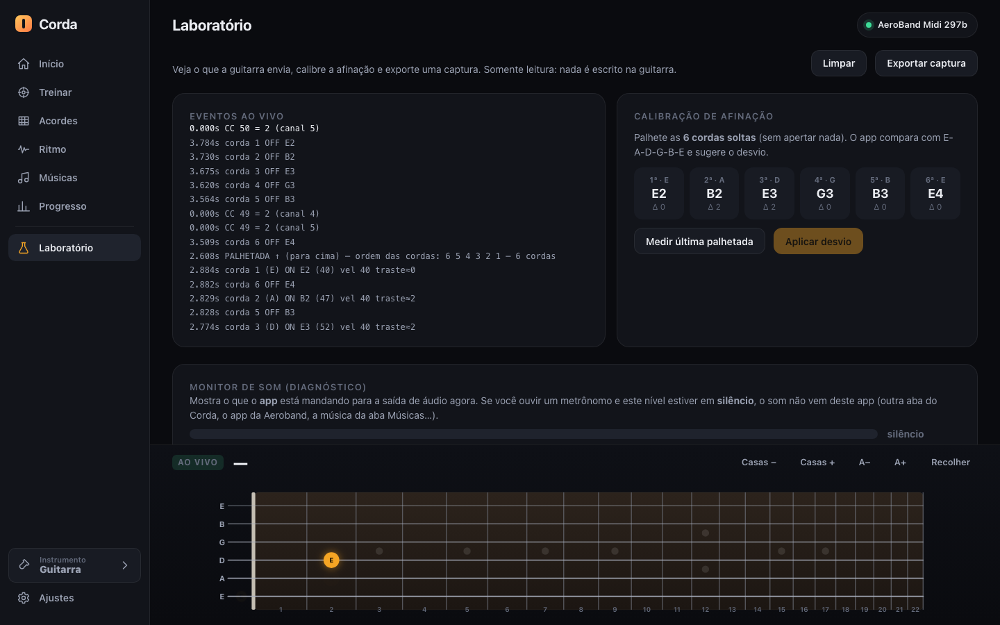

# 01 · AG01 integration

How Corda talks to the AeroBand AG01, what the guitar actually sends (verified on a real unit), what it does **not** send, and how the app turns the raw stream into musical events.

> **Navigation:** [README](README.md) · [Executive summary](00-executive-summary.md) · **01** · [02 Live fretboard](02-live-fretboard.md) · [03 Practice engine](03-practice-engine.md) · [05 Chords](05-chords.md) · [07 Settings, calibration & lab](07-settings-calibration-lab.md) · [08 Insights](08-insights-for-native-app.md) · [09 Limitations](09-limitations-and-method.md)

---

## 1. Scope and method (read this first)

Everything in this page about the guitar's behaviour comes from **passive, read-only listening** to the author's own AG01 (advertised as **"AeroBand Midi 297b"**). Concretely:

- The app subscribes to the standard BLE MIDI characteristic and **only receives** notifications. It never writes a characteristic, never sends SysEx, never touches firmware, memory, pairing data or internal calibration, and never sends an undocumented command. See [Safety](#safety).
- A few short capture sessions were recorded with a separate diagnostic script (also listen-only) while the author followed a spoken script ("press fret 3 on the A string and hold… release…"), plus ad-hoc strumming. Those recordings are the "verified" evidence below.
- Nothing here was obtained by analysing the official AeroBand app. Corda does not use, copy or depend on it.

Labels used throughout this documentation:

| Label | Meaning |
|---|---|
| **Verified** | Observed in the live captures from the real AG01 |
| **Inferred** | Deduced by Corda from verified data (e.g. strum direction from the order in which strings arrive) |
| **Simulated** | Produced by emulated events, used for the screenshots and the automated tests |
| **Not observed** | We looked for it and did not see it (it may still exist) |

---

## 2. Connection

### Purpose
Get the guitar's MIDI stream into the browser with the smallest possible footprint on the device.

### How it works (`js/device/guitar.js`)
1. The user clicks the status chip in the top-right corner (*"Conectar guitarra"* — Connect guitar).
2. The app calls `navigator.bluetooth.requestDevice()` with a **service filter** for the standard BLE MIDI service:
   - Service: `03b80e5a-ede8-4b33-a751-6ce34ec4c700`
   - Characteristic: `7772e5db-3868-4112-a1a9-f2669d106bf3`
   The filter is by *service*, not by device name, so any BLE-MIDI device would appear in Chrome's picker; the AG01 shows up as "AeroBand Midi 297b".
3. After the user picks the device, the app connects GATT, gets the MIDI service and characteristic, registers a `characteristicvaluechanged` listener and calls `startNotifications()`. **That is the only GATT operation the app performs** (enabling notifications is a descriptor write that every BLE MIDI client must do to receive data).
4. Each notification is timestamped with `performance.now()` the moment it arrives, emitted as a raw event (hex string) for the laboratory, then parsed.
5. The chip turns green and shows the device name once connected.

### Connection states (all visible in the chip)
| State | Chip text (Portuguese) | Meaning |
|---|---|---|
| `idle` | *Conectar guitarra* | Not connected |
| `connecting` | *Conectando…* | Picker open / GATT connecting / reconnecting |
| `connected` | the device name (e.g. *AeroBand Midi 297b*) | Receiving MIDI |
| `demo` | *Modo demo* | No guitar: emulated strums (see below) |

### Reconnection
On `gattserverdisconnected` the app clears all held state (pressed frets, sounding strings), shows *Conectando…* and retries up to **3 times, 1.2 s apart**; if all fail it returns to *idle*. This is **Verified** to work with a Bluetooth drop in normal use, but it was not stress-tested.

### Demo mode (no guitar)
*"Experimentar sem guitarra"* (Try without a guitar) switches to `demo`. Keyboard: **Space / ↓** = down-strum, **↑** = up-strum, **X** = deliberately wrong strum. Demo strums are **Simulated**: six note-ons 24 ms apart (velocity 40) and note-offs ~900 ms later. The keys are ignored while a real guitar is connected.

### Platform notes
- Web Bluetooth works in **Chrome on desktop and Android**; not in Safari/iOS. The page must be served from `https://` or `localhost`.
- In our use the AG01 accepted **one connection at a time**: the official app had to be closed before Corda could connect.

---

## 3. What the guitar sends



*The **Laboratório** screen (see [07](07-settings-calibration-lab.md)) lists every message as it arrives. Left panel: note-on/off per string, CC messages with their channel, and the derived "PALHETADA ↑ … ordem das cordas: 6 5 4 3 2 1" line. In this screenshot the events are **simulated**; with a real guitar each packet also appears as a `RAW` hex line.*

### 3.1 Packet format (**Verified**)
Standard BLE MIDI framing: `[header, (timestamp, status, data…)*]`, with running status and several messages per notification allowed. Real examples from the captures (they are also unit tests in `tests/theory.test.mjs`):

```
80 80 94 3b 28          → note-on  ch 4  note 59 (B3)  velocity 40
80 80 b0 7b 00          → control change ch 0  CC 123 = 0  (all notes off)
80 80 b1 32 04 80 80 b1 31 04   → two CCs in ONE notification (CC 50 = 4, CC 49 = 4 on ch 1)
80 80 b2 32 03 80 80 b2 31 04   → CC 50 = 3 and CC 49 = 4 on ch 2 in ONE notification (a finger moving 3 → 4)
```

**Verified:** in every capture we have, the BLE-MIDI header is `0x80` and the timestamp byte is `0x80`, i.e. the guitar sends **timestamp = 0** on every packet. The app therefore timestamps on arrival (see [§6](#6-timing-what-the-app-can-and-cannot-know)).

### 3.2 Messages and their meaning

| Message | Status / data | Meaning | Status |
|---|---|---|---|
| **Note-on** | `9n kk vv` | String *n* was plucked; `kk` is the sounding MIDI note | **Verified** |
| **Note-off** | `8n kk 01` | Previous note on that string ended — seen **right before the same string is plucked again** | **Verified** |
| **CC 49** | `Bn 31 ff` | A finger was **pressed** on fret `ff` of a string (works **without plucking**) | **Verified** |
| **CC 50** | `Bn 32 ff` | The finger on fret `ff` was **released** | **Verified** |
| **CC 123** | `Bn 7B 00` | "All notes off" for that string's channel — produced by the **palm-mute** gesture | **Verified** |
| CC 54 | `Bn 36 vv` | A counter that increases by one with each strum (we saw 4, 5, 6, 7…). **Meaning unknown**; the app ignores it | Observed, not understood |
| System message | `F3 xx` (Song Select) | Appears occasionally. **Meaning unknown**; the app's parser skips it | Observed, not understood |

#### Channel / string map for notes (**Verified**)
One MIDI channel per string, **channel 0 = lowest string** … **channel 5 = highest string**.

| String (physical name) | Channel `n` | Open-string MIDI note |
|---|---|---|
| 6th (low E) | 0 | 40 (E2) |
| 5th (A) | 1 | 45 (A2) |
| 4th (D) | 2 | 50 (D3) |
| 3rd (G) | 3 | 55 (G3) |
| 2nd (B) | 4 | 59 (B3) |
| 1st (high E) | 5 | 64 (E4) |

The sounding note is `open-string note + fret`, so the app derives the plucked fret as `note − open note`. Velocities seen in one ~70-second session ranged from about **12 to 73** (values like `0x0c … 0x49`), so velocity *does* carry playing dynamics; the app uses it only for the size/brightness of the on-screen attack and the optional browser sound.

#### CC 49 / CC 50: the fret sensors (**Verified**)
This is the most useful finding for practice features.

- **CC 49 = pressed, CC 50 = released.** The value is the **fret number** (we saw values 1 through 22, and never 0).
- They arrive **independently of plucking**: you can place a chord on the neck and the guitar reports every pressed fret before any string sounds.
- **One message per change.** While a finger is held still the guitar sends nothing; there is no periodic refresh. In the scripted capture, "press fret 3 on A, hold ~10 s, release" produced exactly one CC 49 and, ten seconds later, one CC 50 carrying the same fret.
- **Channel order is the reverse of the notes' order.** For CC 49/50, channel `c` refers to string index `5 − c` (channel 5 = lowest string). In the scripted capture, pressing the A string arrived on channel 4. *(Worth knowing for anyone parsing the stream: the fret messages use the opposite string order.)*
- While a finger **moves across frets**, CC 49 and CC 50 messages alternate (in the sweep captures they came in pairs with the same fret value, a few hundred ms apart). We did not try to separate "new fret" from "old fret" on the wire: Corda simply ignores a "released" for a fret that is no longer the current one, so the order of the two does not matter.
- Several fingers produce several independent CC 49s (one per string). Whether a **barre** is reported on every covered string is **Not observed** yet.
- **Open strings produce no sensor event**, by construction: nothing is pressed. So "this string is open" is only knowable from the pluck.

#### CC 123 on palm mute (**Verified**)
Muting with the right-hand palm sends CC 123 on the channel of each sounding string. It is the **only** "the string stopped" signal the guitar gives us (see [§4](#4-what-the-guitar-does-not-send)).

#### Strum timing (**Verified**, 4 strums with 5–6 strings)
A "strum" is not an instant. The strings arrive one after another:

| Strum | Strings | Total span | Gaps between consecutive strings |
|---|---|---|---|
| #1 | 6 | 0.51 s | 60, 90, 120, 150, 90 ms |
| #2 | 5 | 0.42 s | 120, 90, 90, 120 ms |
| #3 | 5 | 0.33 s | 90, 90, 90, 60 ms |
| #4 | 5 | 0.66 s | 150, 180, 120, 210 ms |

Down-strokes arrive in **ascending channel order** (low string first). **We have only ever captured down-strokes**, so how an up-stroke looks on the wire is **not verified** (we expect descending order — see [§5.4](#54-strum-direction-inferred)).

#### An early oddity (observed once)
In one early capture every string sounded exactly one semitone lower than standard (for example note 39 instead of 40 on the low string). It was not reproduced in later sessions and we do not know the cause (tuning/capo state?). It is why the app keeps an optional **note-check tolerance** (the *"Desvio de afinação"* setting, see [07](07-settings-calibration-lab.md)); the app **never** shifts the frets it draws because of it.

### 3.3 Other things the guitar exposes (not used by the app)
A separate listen-only enumeration script saw, besides the MIDI service, a **Nordic-UART-style service** and a vendor characteristic that does not support notifications. On subscribing to the UART notify characteristic the guitar sent a short ASCII string (`char1serial_notify`) once. **Corda never touches any of these**; they are mentioned only because AeroBand will know what they are and might want to know they are visible.

---

## 4. What the guitar does **not** send

| Information | Available? | How Corda copes |
|---|---|---|
| Which string was plucked, which note, how hard | Yes (note-on + velocity) | Used everywhere |
| Which fret is pressed (before plucking) | Yes (CC 49/50) | Live fretboard, chord-assembly exercise, "neck" validation |
| When a finger is lifted | Yes (CC 50) | "Lift your hand" rule in the assembly exercise |
| **Strum direction** (down/up) | **No** | **Inferred** from string arrival order; see [§5.4](#54-strum-direction-inferred) |
| **When a plucked string stops ringing** | **No** (except palm mute) | Estimated: the note is considered over after a configurable time (default 2.5 s) |
| **Which finger** is on which fret | **No** | Exercises show finger numbers only as a *guide*, never graded |
| Right-hand fingers (p-i-m-a) | **No** | Shown as a pedagogical "guide" badge, never graded |
| Hammer-on / pull-off / slide / bend / vibrato | **No** (no dedicated events) | Shown as guide only; no accuracy is claimed |
| Fret pressure / "how hard the finger presses" | **No** | — |
| Whether a string is **muted by a finger** vs open | **No** | Open strings only show up when plucked |
| A per-strum summary (start/end, direction, count) | **No** | Computed from the note stream (260 ms silence ends a strum) |
| Real BLE-MIDI timestamps | **No** (always 0) | Arrival time on the host is used |
| Battery, firmware version, tuning, capo | **Not observed** | — |

---

## 5. From raw MIDI to musical events (`js/device/guitar.js`)

The `Guitar` class emits browser events that every screen consumes. This is the whole vocabulary:

| Event | When | Payload |
|---|---|---|
| `raw` | Every BLE notification | `{ t, hex }` |
| `noteon` | Note-on | `{ string (0–5), note, vel, t }` |
| `noteoff` | Note-off from the guitar, or **estimated** end of ringing | `{ string, note, t, estimated? }` |
| `notes` | Whenever the set of sounding strings changes | `{ active: Map(string → note) }` |
| `cc` | Any control change | `{ string, controller, value, t }` |
| `press` / `unpress` | Fret pressed / released (CC 49 / CC 50) | `{ string, fret }` / `{ string }` |
| `strumstart` | First note of a new strum | `{ t }` |
| `strum` | A strum ended | `{ t, notes, dir ('D'/'U'/'S'), order, count, chord }` |
| `status` | Connection state change | `{ status, name }` |

String indices inside the app always run **0 = lowest string … 5 = highest string**. Because CC 49/50 use the reverse channel order, the app converts them (`string = 5 − channel`) at the very edge, so no other module has to remember it.

### 5.1 Plucked notes and "sounding" state
A note-on marks the string as sounding. Because the guitar sends no note-off when a note simply dies out, the app **arms a timer** per string: after `sustainMs` (default **2500 ms**, adjustable 500–8000 ms in steps of 250) the string is declared finished and a synthetic `noteoff` with `estimated: true` is emitted. A palm-mute CC 123 clears the string immediately. Re-plucking a string restarts its timer. **This is an estimate, not a measurement.**

### 5.2 Pressed frets
`CC 49` stores `pressed[string] = fret` and emits `press` (only if the fret changed). `CC 50` removes it **only if the fret matches the current one** (a late "release" of a previous fret is ignored). A **120-second failsafe** removes a mark whose release was lost on the radio; it is a safety net, not part of normal behaviour.

### 5.3 Strum clustering
Note-ons are collected into a strum. The strum **ends after 260 ms with no new note-on** (chosen from the captures: two consecutive strings of a slow strum can be 0.21 s apart, so a smaller gap would split one strum into two). When it ends, `strum` carries the notes in arrival order, their count, a chord name guessed from the pitches (used for the live readout) and the direction below.

### 5.4 Strum direction (**Inferred**)
Direction is derived purely from the **order in which the strings arrive**:

1. Take the distinct strings in arrival order. Fewer than **3** strings → direction unknown (`'S'`).
2. Count ascending pairs and descending pairs among them.
3. Ascending pairs ≥ 2× descending pairs → **down** (`'D'`, low string first). Descending ≥ 2× ascending → **up** (`'U'`). Otherwise unknown (`'S'`).

When direction is unknown the app **never penalises** the player. Unit tests cover both directions, ambiguous orders and the 260 ms separation (`tests/decay.test.mjs`, `tests/engine-evaluator.test.mjs`). **Caveat:** only down-strokes were captured on the real guitar; up-stroke behaviour is assumed from string order. The *Laboratório* prints "PALHETADA ↓/↑" for each strum so any owner can check this on their own guitar in seconds.

---

## 6. Timing: what the app can and cannot know

- **Host arrival time** — each notification is stamped with `performance.now()` when Chrome delivers it. This includes the guitar's own latency, the Bluetooth connection interval and any retransmissions.
- **Conversion to musical time** — the exercise clock converts that stamp to a beat position: `beat = position( audioNow − (performance.now() − t) − latency )`, where `latency` is the user-set **latency compensation** (default 80 ms, range 0–400 ms; see [07](07-settings-calibration-lab.md)).
- **What is not knowable** — how much of the delay is Bluetooth versus the player's own habit versus audio output. The calibration screen measures only the **total**.

Because packets carry timestamp 0, **jitter in the Bluetooth connection interval goes straight into the player's score**. This is the single biggest technical improvement we can think of on the guitar side (see ideas below).

---

## Safety

The guitar's integrity was treated as an absolute constraint:

- The app calls exactly one GATT operation, `startNotifications()` (receive-only).
- It never calls `writeValue*`, never sends SysEx, never writes firmware, memory or calibration, never uses undocumented commands, never pairs/bonds beyond what the browser does, and never opens the UART or vendor characteristics.
- **Enforced by tests.** `tests/safety.test.mjs` scans every source file (comments stripped) and fails on any of: `writeValue…(`, `sendSysEx`, `sysex: true`, `.send([`, `output….send`. A second test asserts that `js/device/guitar.js` contains `startNotifications` and none of the write calls. The guard was **mutation-tested**: injecting a write makes the test fail.
- The Bluetooth capture scripts used for analysis were listen-only as well.

---

## 8. Edge cases and honest limitations

- **One guitar, one author.** Everything marked *Verified* comes from a single AG01 and a handful of sessions. Other units or firmware versions may differ.
- **Up-strokes unverified** on the wire (see §3.2/§5.4).
- **Barre chords:** whether every covered string produces a CC 49 is unknown. The assembly exercise ([05](05-chords.md)) is designed so a missing string is reported precisely ("Falta apertar a corda 5, casa 2").
- **Ringing time is an estimate.** If the guitar had a real note-off, the live fretboard would be exact.
- **CC 54, `F3` and the UART/vendor characteristics** are not understood and not used.
- **Dropped or reordered packets** are not modelled except for the 120 s press failsafe.
- **Latency numbers are user-set**, not measured by the guitar.

---

## 9. Ideas for the native AeroBand app

*Each idea says why it matters and a rough sense of feasibility. They are suggestions from outside the firmware, so feasibility notes are guesses.*

1. **Send real BLE-MIDI timestamps** (13-bit ms). *Why:* removes Bluetooth jitter from timing judgement and makes strum duration measurable on the guitar. *Feasibility:* likely firmware-only and cheap; the standard already defines the field.
2. **Emit a strum summary or a direction flag.** *Why:* the guitar knows the order in which it detected the picks — direction, start and end could be one small message instead of being reverse-engineered from six notes. *Feasibility:* firmware-only; the data already exists in the device.
3. **Document CC 49/50 officially** (and consider a "fret 0 / all released" convention). *Why:* they are the most valuable signal for teaching; developers should not have to discover them. *Feasibility:* documentation only.
4. **Provide a "string ended" signal** (note-off on decay, or a "string quiet" flag). *Why:* lets any app show real sustain and palm-mute states instead of timers. *Feasibility:* depends on how the pickup/detection works; may be harder.
5. **Report barre/multi-finger presses explicitly** (all covered strings, or a single "barre fret N from string a to b" message). *Why:* lets apps verify F, B-minor, etc. *Feasibility:* depends on sensor resolution.
6. **Expose "finger present but not pressed" vs "pressed".** *Why:* muted-string technique and lifting-hand drills become precise. *Feasibility:* sensor-dependent.
7. **A tiny read-only info message** (firmware version, tuning, capo, battery). *Why:* apps can adapt (e.g. the one-semitone-low observation could be explained by a state the app can read). *Feasibility:* firmware.
8. **Publish a one-page BLE MIDI map.** *Why:* it would have saved us the time of capture sessions and lets the community build practice tools that make the guitar more valuable.
9. **A "developer / practice" mode** in the native app that streams exactly these events to other apps over BLE MIDI while the native app is open — avoiding the "one connection at a time" conflict.

See [08](08-insights-for-native-app.md) for how these ideas rank against the app-side ideas.
