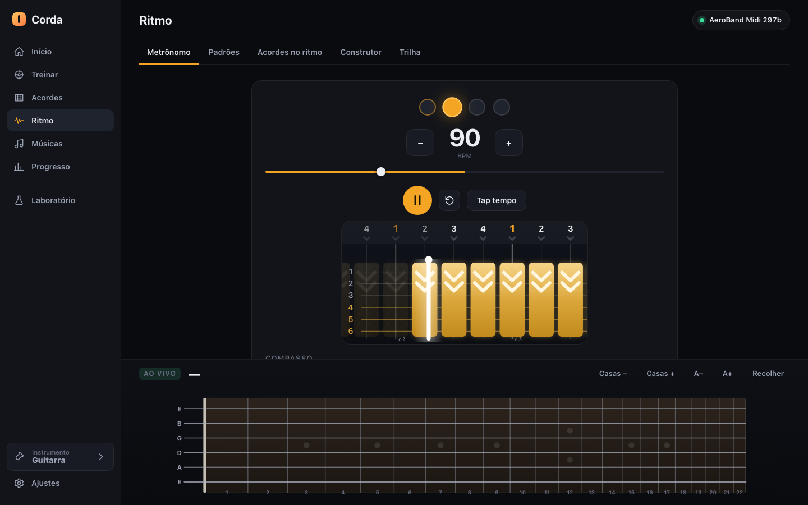
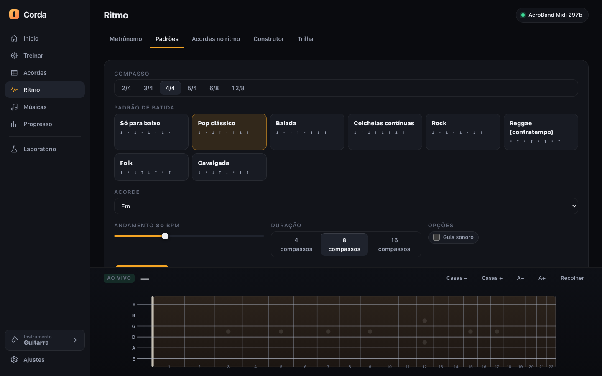
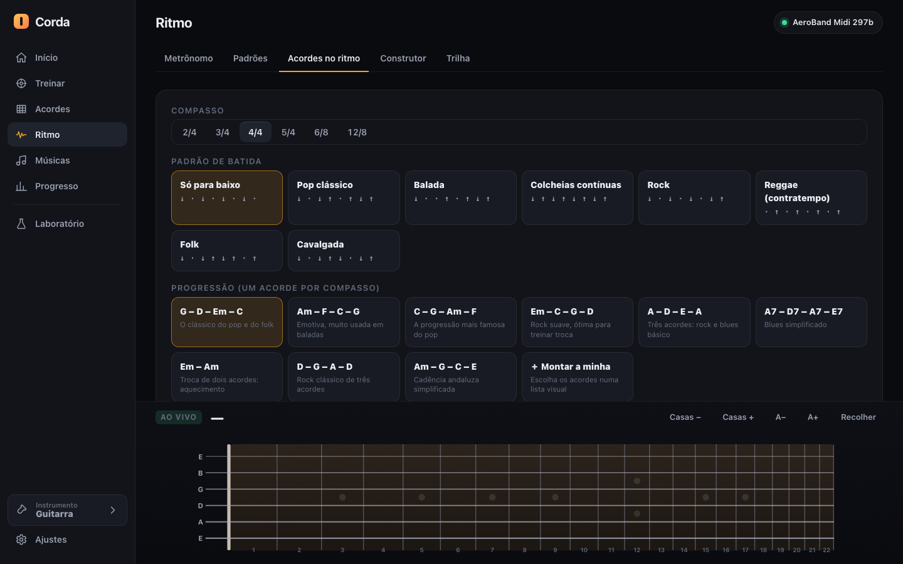
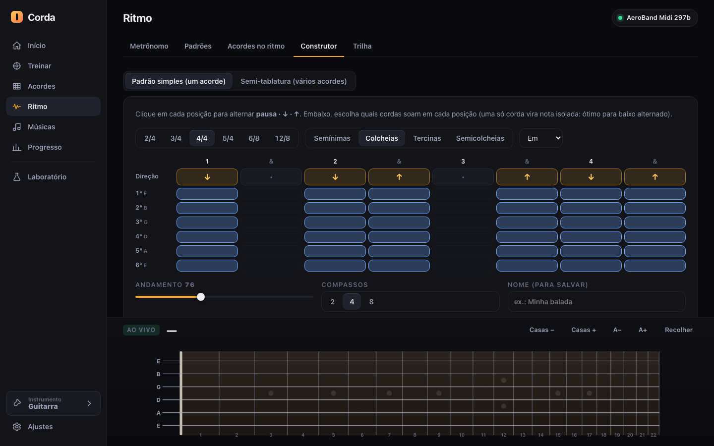
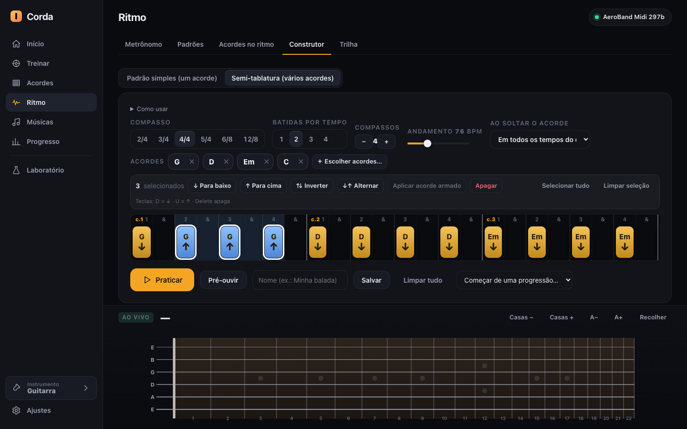
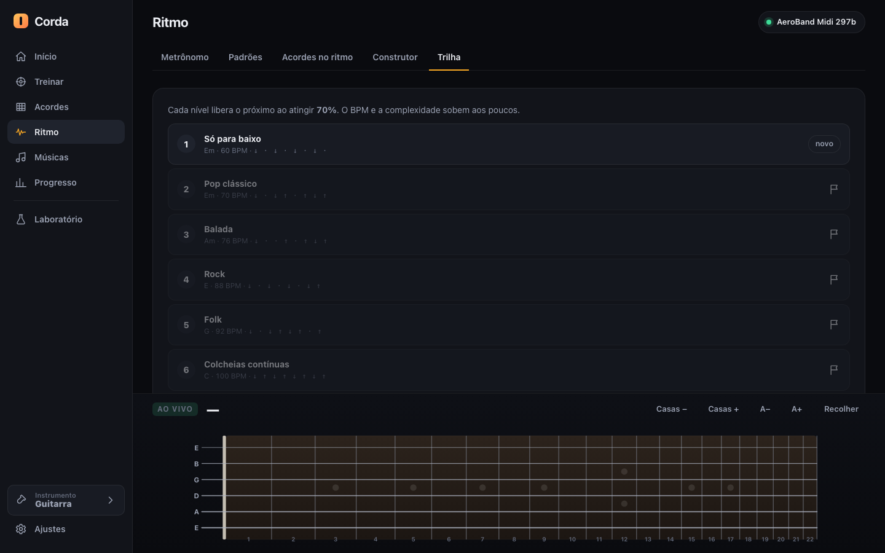

# 04 · Rhythm ("Ritmo")

> Part of the Corda documentation set for the AeroBand team. See also: [03-practice-engine.md](03-practice-engine.md) (how every rhythm exercise is graded) · [05-chords.md](05-chords.md) (chord picker) · [01-ag01-integration.md](01-ag01-integration.md) · [08-insights-for-native-app.md](08-insights-for-native-app.md).
>
> Screenshots use the Portuguese UI with **simulated** guitar input and seeded demo data. Behaviour of the guitar itself (strum timing, direction) is documented in 01 and flagged there as verified / inferred.

## 1. Purpose

Rhythm is the place to work on *time feel* and strumming patterns independently of chord knowledge: a metronome with a visual lane, ready-made strumming patterns for six time signatures, the same patterns running over chord progressions, a **pattern builder** (per-string, and a multi-chord "semi-tablature"), and a 7-step difficulty ladder.

The screen has five tabs: **Metrônomo** (metronome) · **Padrões** (patterns) · **Acordes no ritmo** (chords in rhythm) · **Construtor** (builder) · **Trilha** (level path).

## 2. Metronome tab

**What you see.** Beat dots (the accented first beat in a different colour), a big BPM number with −5 / +5 buttons and a 30–240 BPM slider, Play/Pause, Restart, **Tap tempo**, and a horizontal **lane** (same renderer as in practice, see [03 §4](03-practice-engine.md)) showing one bar of ↓ strum blocks scrolling past the now bar so the metronome is *visible* as well as audible.

**Options.**
- **Compasso (time signature):** 2/4 *Marcha*, 3/4 *Valsa*, 4/4 *O mais comum*, 5/4 *Irregular (3+2)*, 6/8 *Composto: 2 batidas de 3*, 12/8 *Composto: 4 batidas de 3*. The metronome accents **beat 1 of every bar** (a louder, higher, longer click); all other beats use the normal click. The meter table also carries a grouping note (5/4 = 3 + 2, 6/8 = two groups of three) used for display.
- **Subdivisão:** Semínimas (quarters) / Colcheias (eighths) / Tercinas (triplets) / Semicolcheias (sixteenths). Changing meter picks that meter's natural subdivision (3 for 6/8 and 12/8, otherwise 2).
- **Velocidade (prática reduzida):** 50 / 75 / 100 / 125 %. The display shows the *effective* BPM ("BPM · efetivo 60").
- **Clicar subdivisões:** adds a quieter click on subdivisions (988 Hz, 30 ms).
- **+2 BPM a cada 4 compassos:** automatic accelerator, capped at 240.
- **Tap tempo:** averages the intervals of the taps in the last 2.5 s; needs ≥ 2 taps; result clamped 30–240.
- Shortcut `P` = play/pause. BPM and meter are remembered between visits.

**Audio.** Accent click = triangle wave 1568 Hz; normal beat = sine 1047 Hz; look-ahead scheduler 0.2 s; changing BPM or meter re-schedules the future clicks with no gap. No guitar is needed on this tab.

**Ideas for the native app.** The metronome with a *moving* lane (not only blinking dots) trains anticipation, and the accelerator (+2 BPM / 4 bars) is a tiny feature that gets used a lot for speed-building. "Effective BPM" next to a speed percentage avoids confusion when practising at 50 %.

## 3. Patterns tab

**What you see.** Time-signature selector → grid of pattern cards (name + arrows `↓ ↑ ·`) → chord selector → tempo slider (40–160) → length (4 / 8 / 16 bars) → "Guia sonoro" toggle → **Praticar** (practice) and **Editar este padrão no Construtor** (edit this pattern in the builder). A hint reminds demo users: *"Sem guitarra? Use o modo demo: Espaço = ↓, ↑ = ↑."*

**Built-in patterns** (`D` = down, `U` = up, `-` = rest; 8 eighth-note slots in 4/4):

| Pattern (PT name) | Slots | Level |
|---|---|---|
| Só para baixo (down only) | `D-D-D-D-` | 1 |
| Pop clássico | `D-DU-UDU` | 2 |
| Balada | `D--U-UDU` | 2 |
| Rock | `D-D-D-DU` | 2 |
| Colcheias contínuas (continuous eighths) | `DUDUDUDU` | 3 |
| Reggae (contratempo / off-beat) | `-U-U-U-U` | 3 |
| Folk | `D-DUDU-U` | 3 |
| Cavalgada (gallop) | `D-DUD-DU` | 3 |

Other meters have their own sets, e.g. 5/4: "3 + 2" `D-D-D-D-D-` and "Irregular" `D-DUD-D-DU`; 6/8: "Balada 6/8" `D--D-U`, "Cavalgada 6/8" `D-UD-U`; 12/8: "Blues lento" `D--D--D--D--`, "Shuffle 12/8" `D-UD-UD-UD-U`.

**Practising a pattern** hands a generated score to the practice engine: one chord for all bars, each strum carrying direction `D`/`U`, graded for timing + direction (default soft mode) + fret assembly if the sensors report it ([03 §8](03-practice-engine.md)).

**Ideas for the native app.** Patterns drawn as arrows with a visible beat grid are readable by beginners; "edit this pattern in the builder" as a one-click bridge between *consuming* and *creating* is a good pattern to copy.

## 4. Chords in rhythm tab

Same screen as Patterns plus a **Progressão** (progression) row — *one chord per bar*. The nine built-in progressions are: G–D–Em–C, Am–F–C–G, C–G–Am–F, Em–C–G–D, A–D–E–A, A7–D7–A7–E7 (blues), Em–Am, D–G–A–D ("rock clássico de três acordes") and Am–G–C–E ("cadência andaluza simplificada"). A card "pick your own" opens the chord-picker modal (2–16 chords; see [05-chords.md](05-chords.md)) so any sequence — including slash chords and extended voicings — can be strummed with any pattern.

Extra field: **"Usar um padrão meu (salvo no Construtor)"** — use one of *my* saved patterns as the rhythm. The saved pattern's per-slot direction and string selection are applied to every chord of the progression (`cellsProgScore`): strings that the chord does not use are dropped automatically; a slot with one remaining string becomes a single note (alternating-bass feel).

The chord strip and "TROQUE →" pre-warning of the timeline apply ([03 §4](03-practice-engine.md)).

## 5. Builder tab

Two modes (toggle at top): **Padrão simples (um acorde)** and **Semi-tablatura (vários acordes)**.

### 5.1 Simple builder (one chord)

- Header controls: time signature, subdivision, chord dropdown.
- A grid with one column per slot (labelled `1 & 2 & …`, or `1 e & a` in sixteenths, `1 tri let`/`1 e a` for triplets). Row **Direção**: click a cell to cycle **rest → ↓ → ↑ → rest**.
- Below it, six rows (strings 6ª…1ª with names E A D G B E): toggle which strings sound in each slot. Strings the chosen chord does not use are crossed out (✕) and disabled. Selecting a single string turns the slot into an isolated note (ideal for alternating bass); removing all strings turns the slot into a rest.
- Tempo (40–140), length (2 / 4 / 8 bars), name field.
- **Praticar** (graded run), **Pré-ouvir** (listen: plays one bar with the app's synthesised guitar using the chosen chord), **Salvar padrão** (save), **Limpar** (clear).
- Saved patterns appear as chips (**Meus padrões**) with a delete (✕). They are stored locally and reusable in tab 4.

### 5.2 Semi-tablature builder (many chords on a timeline)

*Screenshot: a four-bar sequence (G – D – Em – C), one strum per beat; the three strums on beats 2, 3 and 4 of bar 1 are selected (white outline) and have just been set to ↑ (blue blocks) with the **"↑ Para cima"** button.*

**Purpose.** A lightweight tablature editor. Instead of writing every note, the player places **chords with a strum direction** on a beat grid over several bars. It is "semi" because it keeps *chord + direction + rhythm* but not individual finger movements. The result is converted into a normal exercise (`buildSemiScore` in `js/views/semitab.js`) and graded by the same engine as every other exercise: timeline, chord strip with "TROQUE →", direction check, neck-assembly check.

**The pieces on screen (top to bottom).**

1. **"Como usar" (How to use)** — a collapsible help text.
2. **Grid settings:** *Compasso* (time signature 2/4, 3/4, 4/4, 5/4, 6/8, 12/8) · *Batidas por tempo* (strums per beat, 1–4) · *Compassos* (number of bars, − / +, 1–16) · *Andamento* (tempo slider, 40–160 BPM) · *Ao soltar o acorde* (what a drop fills; see below).
3. **"Acordes" (palette):** chips for the chords you will use (default G, D, Em, C). Each chip can be **dragged** onto the timeline, or **clicked to arm it as a brush** ("Pincel: G — clique na timeline"), after which clicking an empty slot places it. **"＋ Escolher acordes…"** opens the visual chord picker (up to 24 chords; progression presets available; see [05](05-chords.md)); ✕ removes a chip.
4. **Selection toolbar:** counter ("3 selecionados"), then *↓ Para baixo*, *↑ Para cima*, *⇅ Inverter*, *↓↑ Alternar*, *Aplicar acorde armado*, *Apagar*, *Selecionar tudo*, *Limpar seleção* and a reminder of the keys.
5. **The timeline:** one column per slot (bar number "c.1", beat numbers and `&` / `e & a` labels). A placed chord is a block showing its **name and arrow**: gold with ↓, blue with ↑.
6. **Footer:** **Praticar** (practise it), **Pré-ouvir** (hear it with the app's synthesised guitar), a name field with **Salvar** (save), **Limpar tudo** (clear all), and **"Começar de uma progressão…"** (fill the grid from one of the progressions: one chord per bar with ↓ on every beat). Saved items appear below as chips ("Minhas semi-tablaturas") that load on click and delete with ✕.

**What a drop fills ("Ao soltar o acorde").**

| Option (PT) | Effect of dropping a chord at a slot |
|---|---|
| *Só nesta posição* (only this position) | One strum at that slot |
| *Em todos os tempos do compasso* (every beat of the bar) | One strum on each beat of that bar (the screenshot used this) |
| *Em todas as fatias do compasso* (every slice of the bar) | One strum on every subdivision of that bar |

The drop target is highlighted (orange) on every slot that will be filled, so the player sees the effect before releasing the mouse. New strums default to ↓; dropping on a slot that already has a strum replaces the chord but **keeps its direction**.

**Selecting several strums.** Click one; **drag across** slots to select a range; **Shift-click** to extend from the last click; **⌘/Ctrl-click** to add or remove one. The toolbar then edits them all at once:

| Action | Result |
|---|---|
| *↓ Para baixo* / *↑ Para cima* | Sets every selected strum to that direction |
| *⇅ Inverter* | Flips each selected strum (↓→↑, ↑→↓) |
| *↓↑ Alternar* | Needs ≥ 2 selected; makes them ↓ ↑ ↓ ↑ in time order |
| *Aplicar acorde armado* | Puts the armed (brush) chord on every selected slot, including empty ones — it keeps each strum's direction |
| *Apagar* (or `Delete`/`Backspace`) | Removes the selected strums |

**Keyboard.** `D` = ↓ and `U` = ↑ on the selection; when exactly one strum is selected the selection then **advances to the next strum**, so a whole pattern can be keyed in with D/U presses. `Esc` clears the selection; `⌘/Ctrl+A` selects every strum.

**Moving things.** Drag an existing block to another slot to move it (the target is replaced). Changing the time signature, the strums per beat or the number of bars **re-lays the grid** and keeps each strum at the same musical instant whenever it still fits (a strum that would fall outside the new bar is dropped).

**How it is graded.** Each placed chord becomes **one strum** on all strings of that chord's easiest voicing at that slot; slots with nothing placed are silent (there are no explicit rests). The chord strip is built from the chord changes, so "TROQUE →" cues appear automatically.

**Saving.** Items are stored locally under `rhythm.semitabs` (name, grid settings, palette and strums). Saving with an existing name replaces it.

**Edge cases and limits.** Each strum plays *all* strings of the chord shape (per-string choice exists only in the simple builder, §5.1). The grid has no tuplets other than the three-per-beat subdivision. Dragging uses the browser's HTML5 drag-and-drop, which was exercised with emulated events in tests and by hand with a mouse, not on touch screens.

**Ideas for the native app.** (1) **Drag chords onto a beat grid** is the natural way to author a strumming drill; (2) **multi-select + bulk ↓/↑** turns a fiddly edit into one click; (3) the **"keys advance the selection"** trick lets a player type a pattern like a text; (4) **drop modes** (one slot / every beat / every slice) make filling a bar a single gesture; (5) the brush ("armed chord") mode works well with touch because it needs no dragging.

## 6. Path tab (7 levels)

Seven progressive levels, each unlocked at **≥ 70 %** on the previous one (stored as best score per level):

| # | Name | Pattern | BPM | Chord |
|---|---|---|---|---|
| 1 | Só para baixo | `D-D-D-D-` | 60 | Em |
| 2 | Pop clássico | `D-DU-UDU` | 70 | Em |
| 3 | Balada | `D--U-UDU` | 76 | Am |
| 4 | Rock | `D-D-D-DU` | 88 | E |
| 5 | Folk | `D-DUDU-U` | 92 | G |
| 6 | Colcheias contínuas | `DUDUDUDU` | 100 | C |
| 7 | Cavalgada | `D-DUD-DU` | 96 | Em |

Each level is an 8-bar run; the difficulty label of the underlying score grows 1 → 4 (`1 + floor(i / 2)`, max 5). Locked levels are greyed out and not clickable. The *progress* area ([06-home-and-progress.md](06-home-and-progress.md)) also has a broader "Trilhas" (Beginner / Intermediate / Advanced) with step criteria: *N sessions of a technique at ≥ X % accuracy* (80 % default; 70–75 % for harder steps).

## 7. What the rhythm features rely on from the AG01

| Need | Source | Status |
|---|---|---|
| Strum onset time | First string arrival of the strum | Verified on a real AG01 |
| Strum duration / spread | 0.33–0.66 s between first and last string | Verified |
| Down-strum direction | Ascending string order (low E → high E) was observed on every captured strum; mapping it to ↓ is inferred | Order verified; direction inferred |
| Up-strum direction | Descending string order | Implemented, **never observed on hardware** |
| Hand shape during strum | Fret sensors CC49/CC50 | Verified (press/release events) |
| Which strings sounded | MIDI channel per string | Verified |

See [01-ag01-integration.md](01-ag01-integration.md) for the protocol details and [09-limitations-and-method.md](09-limitations-and-method.md) for what remains unproven.

## 8. Edge cases and limitations

- Tap tempo needs at least two taps within 2.5 s and ignores older taps.
- Rhythm exercises only grade strums that the guitar actually reports; a very soft strum may not produce six MIDI notes.
- The metronome tab is not graded; it never records sessions.
- 5/4 and compound meters are practised with the same engine but the pattern sets are small (two per meter).
- The accelerator changes BPM only at bar boundaries; it does not stop at a target BPM other than the 240 cap.

## 9. Ideas for the native AeroBand app

1. **Moving metronome lane** + accelerator + tap tempo — all trivially cheap, all used constantly.
2. **Six meters with their natural subdivisions** (compound 6/8, 12/8 treated as triplet feel) — many apps stop at 4/4.
3. **Patterns as arrows + beat grid**, editable in one click, then reusable across chord progressions (*pattern × progression* separation).
4. **Direction awareness**: because the AG01 sends per-string arrival order, ↓/↑ can be *checked*, not only shown.
5. **Semi-tablature** for user-authored songs/exercises — much quicker to author than full tab.
6. **Unlockable level path** with a fixed pass mark (70 %) gives a clear goal without needing accounts.
