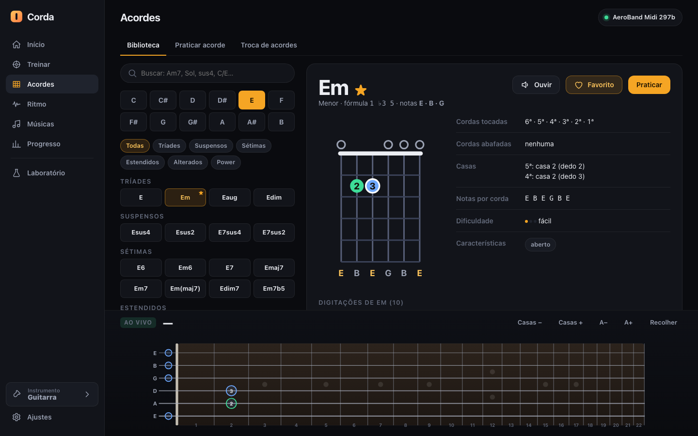
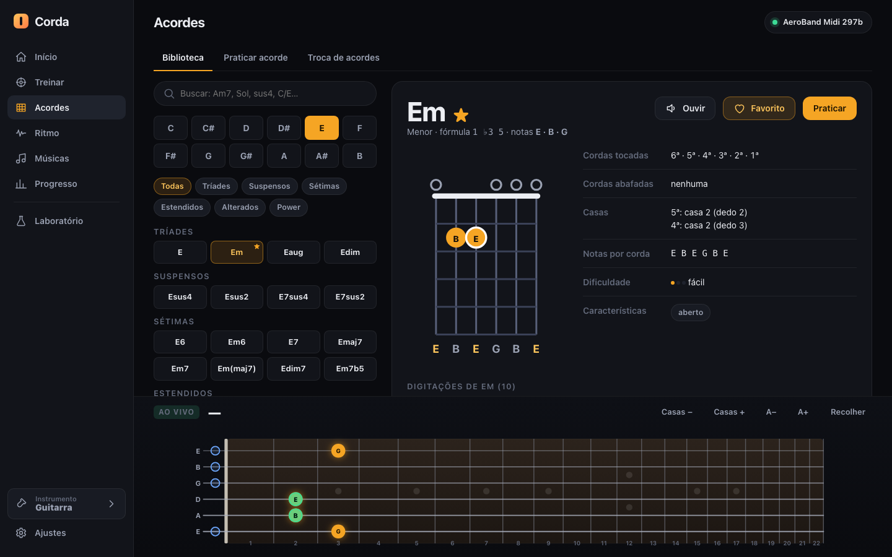
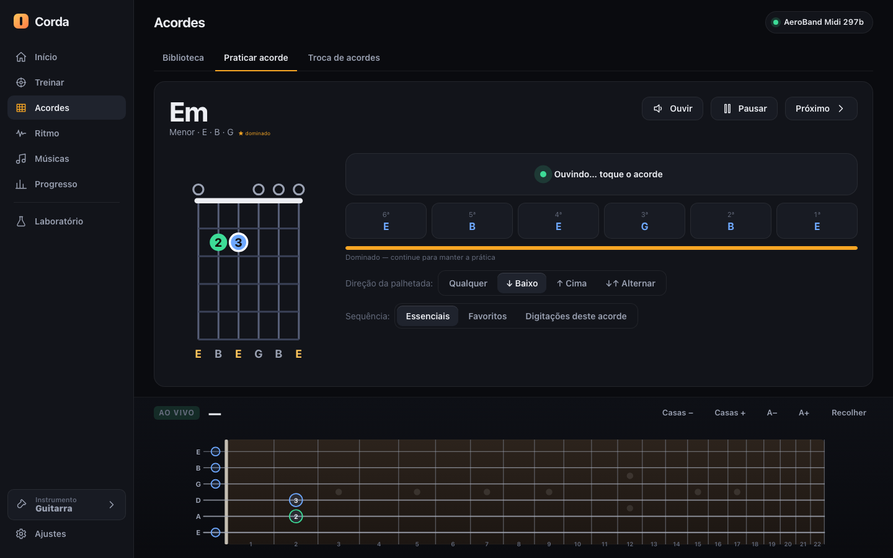
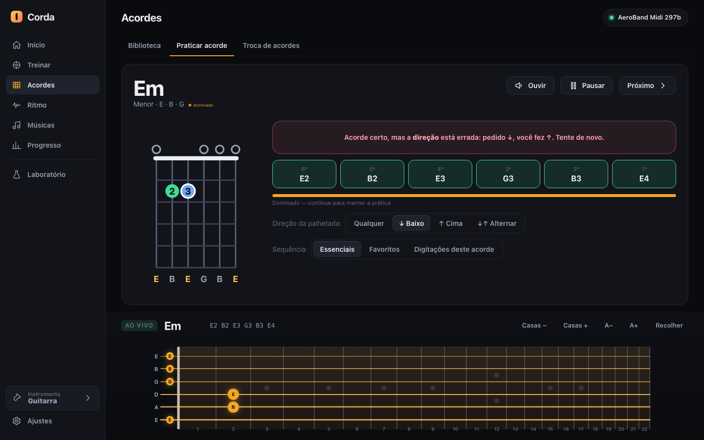
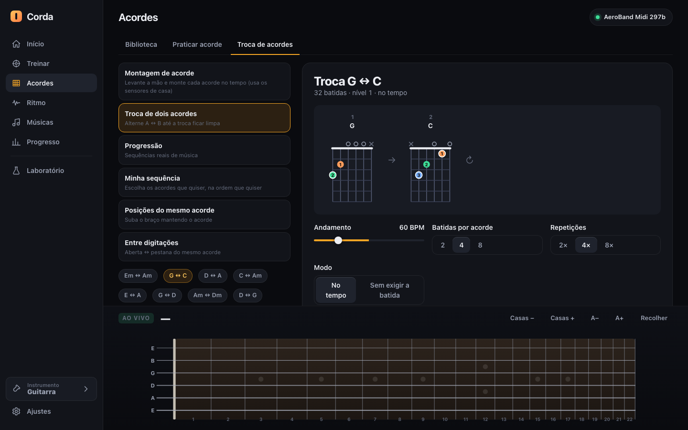
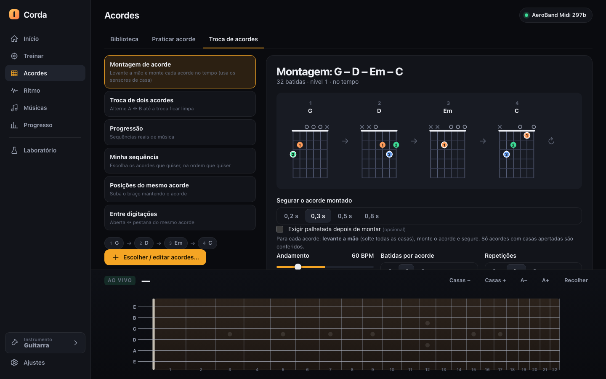
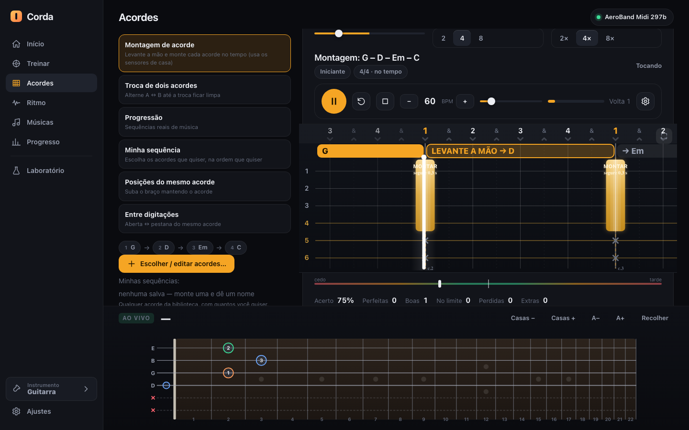
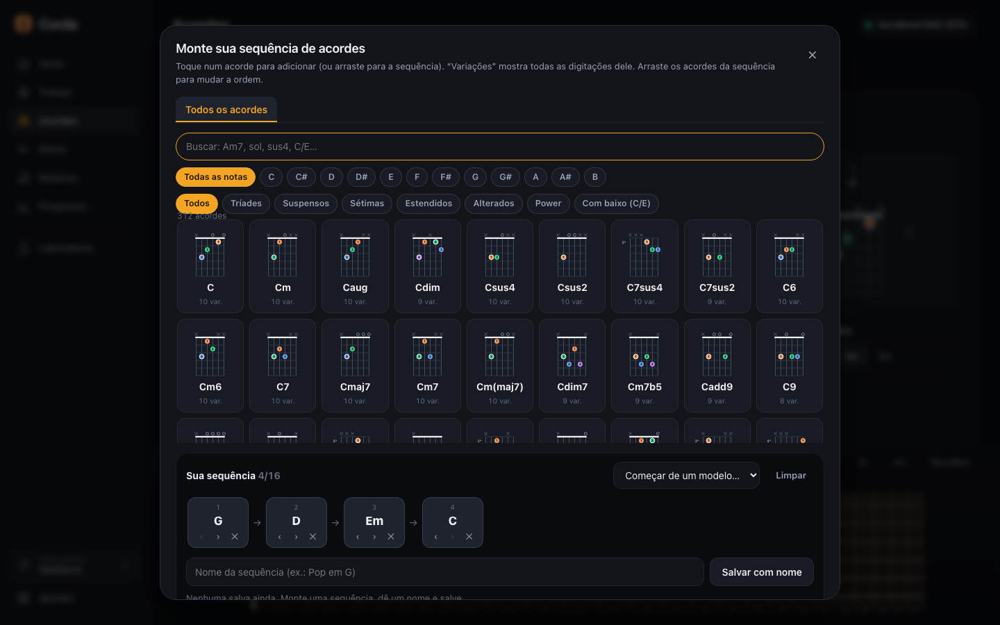
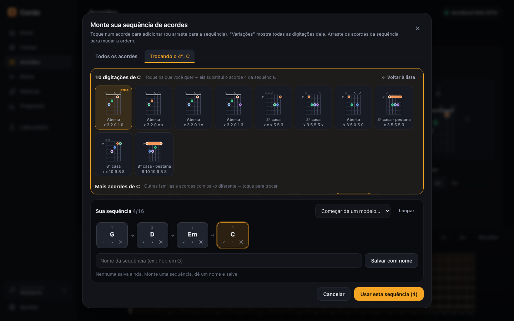

# 05 · Chords

> Part of the Corda documentation for the AeroBand team. See the [index](README.md), the [AG01 integration facts](01-ag01-integration.md), the [practice engine](03-practice-engine.md) and the [insights for a native app](08-insights-for-native-app.md).

**Evidence legend used on this page**

| Tag | Meaning |
|---|---|
| **[VERIFIED-AG01]** | Observed in passive captures from a real AG01 (see page 01). |
| **[CODE]** | A rule that exists in the app's code and unit tests; deterministic, but not tied to hardware behaviour. |
| **[INFERRED]** | Reasoned from captures, not proven on hardware. |
| **[SIMULATED]** | Appears in the screenshots, which were produced with a simulated guitar and demo data. |

> **Screenshots.** Every image on this page was generated by `tools/capture-docs.mjs` in headless Chrome. The guitar shown as "AeroBand Midi 297b" is **simulated** (synthetic MIDI events fed to the same parser as the real device). Numbers such as "dominado" or accuracy percentages come from **seeded demo data**. UI labels are in Portuguese (Brazil); translations are given in parentheses.

---

## 1. Purpose

The **Acordes** (Chords) section is where a player learns the vocabulary of chords and then rehearses it with feedback from the instrument. It has three tabs:

1. **Biblioteca** (Library): browse every chord symbol, see fingerings, hear them, favourite them.
2. **Praticar acorde** (Practice chord): play one chord at a time; the app tells you which strings sounded, whether the chord is right, and whether the strum direction was right.
3. **Troca de acordes** (Chord change): timed drills against a metronome, including an exercise that uses the AG01 fret sensors to check that you *assemble* the shape correctly.

Everything on this page is **read-only toward the guitar**: the app only listens to the AG01 (notes and fret-sensor controller messages). It never sends anything to the device (see [01](01-ag01-integration.md)).

*Figure 5.1 — Library tab. Left: search, root-note chips, category chips and the chord grid. Right: detail panel for Em. Bottom: the live fretboard dock showing the guitar's current state. [SIMULATED]*

---

## 2. The chord library (Biblioteca)

### 2.1 What is in it **[CODE, numbers computed by running the generator]**

The library is **generated by rules**, not typed by hand. A chord is a *root* (12 pitch classes) × a *quality* (26 qualities) = **312 chord symbols**. For each symbol the generator produces fingerings ("voicings", shown to the user as *digitações*):

| Fact | Value |
|---|---|
| Roots | 12 (C, C#, D, D#, E, F, F#, G, G#, A, A#, B) |
| Qualities | 26 |
| Chord symbols | **312** |
| Root-position voicings (all symbols) | **2,892** |
| Difficulty split 1 / 2 / 3 (easy / medium / hard) | 771 / 1,738 / 383 |
| Inversion voicings (only maj, min, 7, maj7, m7) | 780 |
| Slash chords ("Com baixo", e.g. C/E) | 156 symbols |
| Voicings per chord, cap | 7 generated + curated open shapes (e.g. Em shows 10) |

Tag counts across all voicings: *curado* (curated) 46 · *aberto* (open) 583 · *iniciante* (beginner) 660 · *móvel* (movable) 2,317 · *pestana* (barre) 955 · *jazz* 813 · *power* 128.

The 26 qualities are grouped into six categories shown as chips: **Tríades** (triads), **Suspensos** (suspended), **Sétimas** (sevenths), **Estendidos** (extended: 9/11/13/add9…), **Alterados** (altered), **Power**. A seventh option, **Com baixo (C/E)**, lists slash chords (a chord over a different bass note).

### 2.2 How voicings are produced **[CODE]**

Each chord is described by a *formula* (set of pitch classes, e.g. minor = 1, ♭3, 5). The generator:

1. Starts from **curated open shapes** (`chord-data/open.js`, the shapes every beginner book teaches: Em, Am, C, G, D, A, E, …).
2. Adds a **beginner shape** where one exists.
3. Adds **movable shapes** rooted on the E, A, D and G strings (barre/CAGED-style families), transposed to the requested root.
4. Caps the list at `MAX_PER_CHORD = 7` generated shapes plus the curated ones.

Every candidate must pass `validateVoicing`, which enforces:

- every sounded string's pitch class belongs to the chord formula;
- all **must-tones** are present (root, the third or the suspension, the seventh when the symbol has one);
- the fret span is **≤ 4 frets**;
- **≤ 4 fingers** are needed (a barre counts as one finger);
- finger numbers and the barre are coherent (a barre covers exactly the strings it claims, with no finger "inside" it that contradicts it).

Rejected shapes are silently dropped, so what the user sees is always playable by a human hand. Difficulty (1–3) is derived from a raw effort score (fretted strings and span) mapped as ≤3 → 1, ≤6 → 2, otherwise 3; any voicing that needs a barre is at least 2. The tag *iniciante* goes to difficulty-1, barre-free shapes that sound 3–5 strings.

### 2.3 Search and symbol parsing **[CODE]**

The search box ("Buscar: Am7, Sol, sus4, C/E…") accepts:

- English letter names (`Am7`, `F#m`, `Bb`),
- **Portuguese note names** (`Dó`, `Ré`, `Mi`, `Fá`, `Sol`, `Lá`, `Si`) — `parseSymbol` maps them to the same roots,
- quality aliases (`maj7`, `M7`, `min`, `m`, `sus4`, `dim`, `aug`, `7b5`, …),
- slash notation (`C/E`).

Typing narrows the grid live; the root-note chips and category chips combine with the search text.

### 2.4 Detail panel **[SIMULATED screenshot, CODE behaviour]**

For the selected chord (Figure 5.1, Em) the right-hand panel shows:

- **Title** "Em" with a ★ if the chord is a favourite, plus the subtitle "Menor · fórmula 1 ♭3 5 · notas E · B · G" (quality, formula, note names).
- Buttons: **Ouvir** (Listen: plays the chord through the built-in audio engine), **Favorito** (toggle), **Praticar** (jump to the Practice tab with this chord).
- A **chord diagram** (SVG). Fingers 1–4 are coloured (theme variables `--f1…--f4`); the root note has a white ring; open strings are drawn as circles above the nut and muted strings as ×; a barre is a rounded bar.
- A property table:
  - **Cordas tocadas** (strings played): "6ª · 5ª · 4ª · 3ª · 2ª · 1ª";
  - **Cordas abafadas** (muted strings): "nenhuma";
  - **Casas** (frets): "5ª: casa 2 (dedo 2) / 4ª: casa 2 (dedo 3)";
  - **Notas por corda** (note per string): E B E G B E;
  - **Dificuldade**: three dots + a word (fácil / médio / difícil);
  - **Características**: tag chips (here "aberto").
- Below the fold, **"Digitações de Em (10)"**: a grid of all 10 voicings for that chord. Clicking one makes it the current fingering everywhere (diagram, Listen, Practice).

*Figure 5.2 — The same screen scrolled to the voicing list. The dock at the bottom is the live fretboard. [SIMULATED]*

### 2.5 The diagram reacts to the guitar **[CODE; sensor semantics VERIFIED-AG01]**

`bindDiagramPress` links the diagram to the live fret sensor (CC 49/50, see [01](01-ag01-integration.md)). While a string's fret is pressed on the real instrument:

- the corresponding dot in the diagram changes from the **finger number** to the **note name** actually being held (tiny 6.5 px bold label),
- the dot is recoloured to the accent colour,
- when the string is released the original finger number and colour return.

Figure 5.3 shows this: the two Em dots read "B" and "E" in the accent colour, and the live fretboard at the bottom shows green (expected, held correctly) and orange (pressed but not part of the chord) markers. The mapping from sensor channel to string is `string = 5 − channel` (the sensor's channel order is inverted relative to the note channels) **[VERIFIED-AG01]**.

*Figure 5.3 — Simulated press of frets on the 5th/4th string (green, correct for Em) and an extra note on string 6/1 fret 3 (orange, not in the chord). [SIMULATED]*

### 2.6 Favourites and persistence **[CODE]**

Favourites are stored under `favorites.chords` in the app's local storage (`corda.v2`). The ★ also decorates the chord's chip in the grid (visible on "Em" in Figure 5.1). Nothing leaves the browser.

---

## 3. Practice chord (Praticar acorde)

### 3.1 Purpose

A free-time loop: the app shows a chord, you play it, the app confirms. No metronome. This is the "did I land the shape and strum it cleanly?" exercise.

*Figure 5.4 — Waiting for a strum. The status bar says "Ouvindo… toque o acorde" (Listening… play the chord). The six cells show the expected note of each string (6ª→1ª). [SIMULATED]*

### 3.2 What you see

| Element | Behaviour |
|---|---|
| Large chord name + small subtitle ("Menor · E · B · G") and a "★ dominado" badge | Badge appears when the chord has **3 consecutive correct attempts** (`stat.streak ≥ 3`) |
| **Ouvir / Pausar / Próximo** (Listen / Pause / Next) | Listen plays the reference; Pause stops listening; Next advances in the sequence |
| Chord diagram | Same SVG as in the library |
| Status banner | Neutral "Ouvindo…", green when correct, red when wrong, with a reason |
| Six string cells | Each shows the **expected** note (e.g. "E") before the strum; after a strum it shows the **detected** pitch with octave (E2 B2 E3 G3 B3 E4) and turns green/red per string |
| Mastery bar | Orange progress toward 3-in-a-row, caption "Dominado — continue para manter a prática" |
| **Direção da palhetada** | `Qualquer` (any) · `↓ Baixo` · `↑ Cima` · `↓↑ Alternar` |
| **Sequência** | `Essenciais` (the 8 essential chords) · `Favoritos` · `Digitações deste acorde` (all voicings of this chord) |

### 3.3 How a strum is judged **[CODE]**

1. The parser groups notes into a **strum** when consecutive notes arrive less than `STRUM_GAP_MS = 260 ms` apart. This constant was raised from 140 ms after real AG01 captures showed strums spread over **0.33–0.66 s** with individual gaps up to 0.21 s **[VERIFIED-AG01]**. See [01](01-ag01-integration.md) for the capture details.
2. The evaluator waits for the strum to **finish** (deferred resolution) so that late strings are not counted as errors.
3. It compares the set of detected string/pitch pairs with the voicing using `matchVoicing`, which has three **rigor** levels:

   | Rigor | Passes when… |
   |---|---|
   | `root` | the root note was sounded |
   | `normal` (default) | all **essential tones** sounded: root + third (or the suspension) + seventh when the chord has one; extra variations are accepted (e.g. add9, or a different bass → slash chord) |
   | `strict` | every string of the voicing sounded, with the exact pitch |

4. Direction (`dirMode`) is then applied: *any* ignores it; *Baixo/Cima/Alternar* require ↓, ↑ or alternating.

   Figure 5.5 shows a correct chord with the wrong direction: the banner reads "Acorde certo, mas a direção está errada: pedido ↓, você fez ↑. Tente de novo." (Right chord, wrong direction: asked ↓, you did ↑. Try again.) and the six cells show the detected pitches in green.

*Figure 5.5 — Direction feedback. The live dock (bottom) lists the detected pitches E2 B2 E3 G3 B3 E4 and shows them on the fretboard as open strings plus the two fretted notes. [SIMULATED]*

### 3.4 Strum direction: what is known and what is not **[VERIFIED-AG01 + INFERRED]**

The AG01 does not report strum direction. The app **infers** it from the *order* in which the six string channels deliver their notes: ascending string index = down-strum (↓), descending = up-strum (↑).

- Only **down-strums** were present in the captures made so far. The arrival order of an up-strum is **unverified** on hardware. If it is not simply the reverse order, the ↑ rule would be wrong.
- Because of that uncertainty the default for rhythm exercises is `dirMode = soft` (a wrong direction downgrades "perfect" to "good" but never counts as a miss). The strict mode exists for users who want it. In this Chord Practice tab the direction selector offers Qualquer / ↓ / ↑ / ↓↑ Alternar ("alternate": the expected direction flips after each correct attempt).

> **Native-app note.** A single firmware flag "strum direction" (or a timestamp per string with sub-10 ms resolution) would turn this inference into a fact. See [08](08-insights-for-native-app.md).

### 3.5 Sequences and mastery **[CODE]**

- **Essenciais** = `['Em','Am','E','A','D','C','G','Dm']`.
- **Favoritos** = chords with ★.
- **Digitações deste acorde** = the same chord's voicings, one after the other (useful to compare open vs barre shapes).
- Each attempt updates `store.chords[id] = {tries, ok, streak, …}`. A wrong attempt resets `streak` to 0. Mastery = `streak ≥ 3`. The Progress → Acordes tab ([06](06-home-and-progress.md)) lists these.

### 3.6 Edge cases and limits

- With no guitar connected the tab shows "Conecte a guitarra, ou aperte Espaço para testar no modo demo"; in demo mode the Space bar triggers a simulated strum ("Demo: aperte Espaço para palhetar"). **[CODE]**
- A chord whose voicing contains muted strings (×) ignores those strings in the comparison; a sounded muted string counts as an extra and lowers the result unless the rigor is `root`.
- Open strings are checked by *pitch* only. The AG01 reports a fret sensor, but for open strings no sensor event exists, so "this string should be open" is verified by the **absence** of a fret-pressed state **[CODE; sensor semantics VERIFIED-AG01]**.
- Barre (pestana) chords: the app expects fret events on each covered string. Whether the AG01 emits one sensor event per string under a barring finger is **untested on hardware** (open item).

---

## 4. Chord change (Troca de acordes)

This tab hosts all timed chord drills. The left column picks the *kind* of drill, the right column configures and starts it; once started, the shared practice lane (see [03](03-practice-engine.md)) takes over.

*Figure 5.6 — Six drill kinds (left), preset pairs (bottom left), and the configuration for "Troca G ⇔ C" (right): tempo 60 BPM, beats per chord 2/4/8, repetitions 2×/4×/8×, mode "No tempo" or "Sem exigir a batida". [SIMULATED]*

### 4.1 The drill kinds **[CODE]**

| # | Label (PT) | Translation | What it generates |
|---|---|---|---|
| 1 | **Montagem de acorde** | Chord assembly | Lift your hand, then build each chord shape on the beat; uses the fret sensors (see §4.3) |
| 2 | **Troca de dois acordes** | Two-chord change | Alternate A ↔ B until the change is clean. 10 preset pairs: Em↔Am, G↔C, D↔A, C↔Am, E↔A, G↔D, Am↔Dm, D↔G, … |
| 3 | **Progressão** | Progression | Real-world sequences. 8 presets (e.g. "Pop clássico G–D–Em–C") |
| 4 | **Minha sequência** | My sequence | Any chords you pick, in any order (up to 16), via the picker (§5) |
| 5 | **Posições do mesmo acorde** | Positions of the same chord | Same chord moved up the neck (C, G, Am, E, A7, Dm presets) |
| 6 | **Entre digitações** | Between voicings | Open ↔ barre voicing of the same chord |

### 4.2 Common configuration **[CODE]**

| Control | Values |
|---|---|
| Andamento (tempo) | **40–140 BPM** slider (default 60) |
| Batidas por acorde (beats per chord) | 2 · **4** · 8 |
| Repetições (rounds) | 2× · **4×** · 8× |
| Modo | **No tempo** (timed: the lane scores timing) · **Sem exigir a batida** (wait mode: the lane waits for you; no timing score) |

The label under the title summarizes the drill: "32 batidas · nível 1 · no tempo" (32 beats = 4 chords × 4 beats × 2 repeats in that screen). The embedded diagram strip shows each chord with its fingering, an arrow between chords and a loop icon at the end.

### 4.3 Chord assembly ("Montagem de acorde") — the sensor-based drill **[CODE; sensor facts VERIFIED-AG01]**

*Figure 5.7 — Assembly drill G–D–Em–C. Options: hold time 0,2 / 0,3 / 0,5 / 0,8 s and an optional "Exigir palhetada depois de montar" (require a strum after assembling). [SIMULATED]*

**Idea.** Most chord-change exercises only check the *sound*. Beginners often make the sound with the wrong fingers or pause long before the change. With the AG01's per-string fret sensor, the app can check the **hand**, not just the audio.

**Rule set** (all in `evaluator.js`, "MONTAGEM" section; each is covered by unit tests):

1. **Lift.** Before a chord is expected, the previous chord must be complete and then `pressed.size === 0`: *all* fret sensors released. The lane shows "LEVANTE A MÃO → D" (lift the hand → D).
2. **Exact frets.** The assembled shape must equal the voicing: each required string at the required fret; strings expected as open (fret 0) or muted must **not** be pressed.
3. **Hold.** The correct shape must be held for the configured time (0.2 / **0.3** / 0.5 / 0.8 s).
4. **Optional strum.** If enabled, a strum after the assembly is required (judged by the rules in §3.3).
5. **Timing.** The timestamp of the judgement is the moment the assembly *became correct* (and then held), compared with the beat's windows (perfect/good/ok). If it became correct after `T + ok` it is "late"; the window scale follows the tolerance setting (strict 0.6, normal 1, wide 1.6).
6. **Without sensor data** (e.g. in demo mode) the item is resolved as "no limite" with the reason `nosensor`, so the drill never breaks.

During play, the lane block says "MONTAR segure 0,3 s" (assemble, hold 0.3 s) and the chord strip shows the current chord and "→ Em" for the next. The dock marks the expected frets: green rings where a finger belongs, red dashed × on strings that must stay unpressed or muted.

*Figure 5.8 — Assembly in progress: gold block (the acceptable window), "LEVANTE A MÃO → D" strip, result counters (Acerto 75%, Perfeitas 0, Boas 1, …). The dock shows the G shape held. [SIMULATED]*

**Why this matters for hardware.** This drill is only possible because the AG01 sends CC 49 (pressed fret value 1–22) and CC 50 (released fret value) per string channel **[VERIFIED-AG01]**. Resolution of the "all released" condition depends on the device always sending CC 50 on release; in the captures no release with value 0 ever appeared.

### 4.4 Chord-change timeline **[CODE]**

For the other kinds the lane shows, above the beat grid, a chord strip: the current chord (solid gold), the next chord ("→ Em"), and a chord-change instruction **"TROQUE → X"** (change to X) shortly before the change ("soon" window; the same strip says "LEVANTE A MÃO →" in assembly drills). The scoring applies the same neck/sound/timing validation rules from [03](03-practice-engine.md).

### 4.5 Result accounting

At the end of a drill the app records one session: technique `chord-change` (or `chords`), BPM, duration, accuracy, mean timing, per-grade hits, chords OK/total. It appears in [06](06-home-and-progress.md) (History, Techniques, Paths).

---

## 5. Chord picker modal ("Monte sua sequência de acordes")

Opened from "Escolher / editar acordes…" in the *Minha sequência* and *Montagem* drills.

*Figure 5.9 — The picker: search, 12 root chips + "Todas as notas", category chips, the 312-chord grid with a mini diagram and a "N var." (variations) count, and the sequence tray at the bottom. [SIMULATED]*

**Behaviour [CODE]**

- **Tap** a chord to append it; **drag** it into the tray at a given position.
- The tray ("Sua sequência 4/16") holds **up to 16 chords**; each chip has `‹ ›` (move) and `×` (remove) controls; chips are **drag-and-drop reorderable**.
- "Começar de um modelo…" (start from a template) fills the tray with one of the preset progressions.
- **Nome da sequência + Salvar com nome** stores a named sequence under `chords.sequences` (local storage). Saved sequences reappear in the drill panel under "Minhas sequências".
- **Limpar** clears the tray; **Usar esta sequência (4)** confirms.

### 5.1 Variations tab ("Trocando o Nº")

Each grid tile shows "10 var." — click a chip *in the tray* (or the variations action) to open the **voicing chooser** for that position.

*Figure 5.10 — "Trocando o 4º: C". All 10 voicings of C, each with its shape label (Aberta, 3ª casa, 8ª casa · pestana…) and string-fret code like `x32010`. "atual" marks the one currently in the sequence. Below: "Mais acordes de C" lists related families and slash chords (39 related entries for G). [SIMULATED]*

Choosing a voicing **replaces** that position only; the rest of the sequence is untouched. This lets a teacher build "open C → barre C" style exercises or a real song's exact voicings.

---

## 6. Data model, storage and privacy **[CODE]**

| Key (`corda.v2`) | Content |
|---|---|
| `favorites.chords` | array of chord ids |
| `chords` | per-chord `{tries, ok, streak, last…}` stats |
| `chords.sequences` | saved named sequences |
| `sessions` | one entry per finished drill (see [06](06-home-and-progress.md)) |

All stored locally in the browser (localStorage). There is no account, no server, no telemetry.

---

## 7. Edge cases and honest limitations

1. **Pitch shift.** Some captures showed the *whole device shifted −1 semitone* **[VERIFIED-AG01]**. The evaluator compares pitch classes with an optional transpose, but a silent −1 shift (e.g. a detuned or half-step-down setting) would make chords read as wrong. The app does not currently detect or correct this automatically.
2. **No note-off on release** **[VERIFIED-AG01]**: the AG01 emits no note-off when a string is released; a string "decays" in the app after `sustainMs` (default 2,500 ms) or is muted by CC 123 (all-notes-off, sent per string for palm mute). Chord judging therefore uses *note-on events inside the strum window*, not "held notes".
3. **Strings expected open** depend on the *absence* of fret events. A stuck sensor state would make "open" strings look pressed.
4. **Barre sensor behaviour unverified** (see §3.6).
5. **Voicing quality** is a rule-based generator plus curated open shapes. It guarantees playability by the rules above, but it is not a replacement for a pedagogically curated chord dictionary; some of the 2,892 voicings (especially jazz extended chords) are theoretically valid yet rarely used.
6. **Up-strum order** unverified (see §3.4).
7. **Latency.** Audio feedback ("Ouvir") is generated in the browser; Bluetooth headphones add their own delay, which is not measured by the app.
8. The screenshots on this page use **simulated** events and **demo** statistics; the percentages shown are not measurements of a real player.

---

## 8. Ideas for the native AeroBand app

1. **Chord assembly as a first-class drill.** The per-string fret sensors let a native app grade *the hand*, not only the sound. The rule set in §4.3 (lift → exact frets → hold → optional strum) is small, deterministic and already works with the AG01's CC 49/50 messages. A visual "LEVANTE A MÃO" cue was the most effective guidance in our testing.
2. **Show note names on the diagram while pressing.** Swapping finger numbers for the note actually held (Figure 5.3) teaches the fretboard by osmosis with no extra screen.
3. **Rule-generated library with a playability validator.** Generating voicings from formulas and filtering by span ≤ 4 frets, ≤ 4 fingers, must-tones present yields hundreds of chords with no manual typing, and keeps room for curated shapes on top.
4. **Variations in the sequence builder.** Let users change the *voicing* of one chord in a progression without touching the others.
5. **Tolerant chord matching by "essential tones".** Root + third + seventh rather than "all six strings" avoids frustrating beginners; offer a strict mode for advanced users.
6. **Direction feedback (↓/↑).** Valuable for rhythm teaching, but it needs a reliable source. A firmware-level direction flag, or microsecond-accurate per-string timestamps, would replace our inference (§3.4).
7. **Mastery = 3 in a row.** A tiny, understandable rule; a native app might add spaced repetition on top.
8. **Portuguese (and other) note names in search** ("Sol", "Lá") are trivial to support and welcomed by Brazilian users.

For the global list of suggestions see [08-insights-for-native-app.md](08-insights-for-native-app.md).
