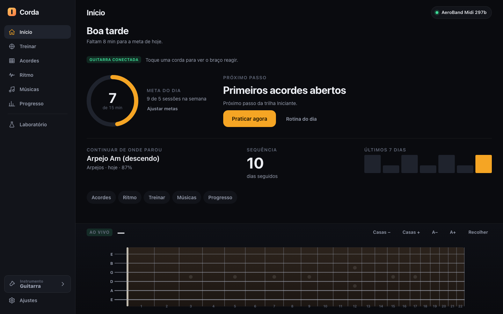
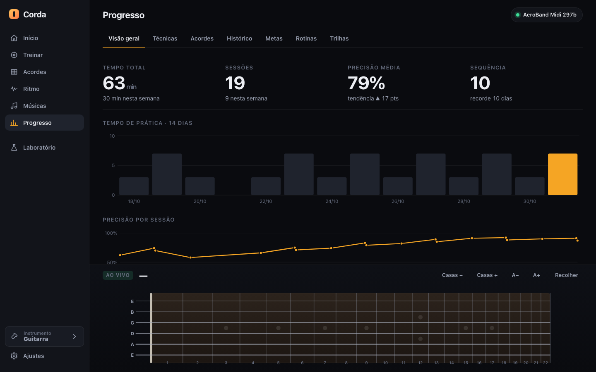
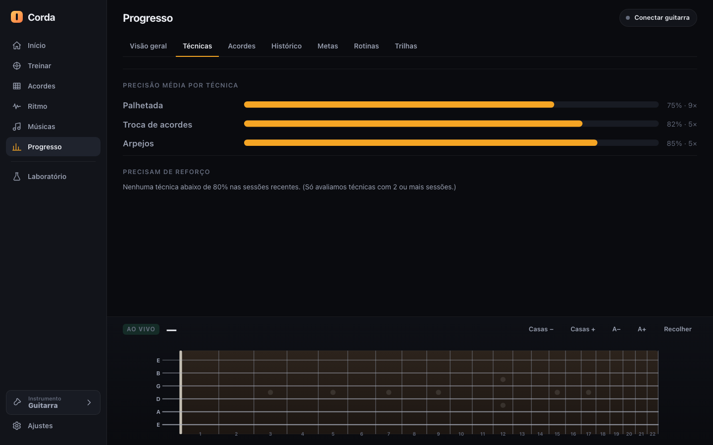
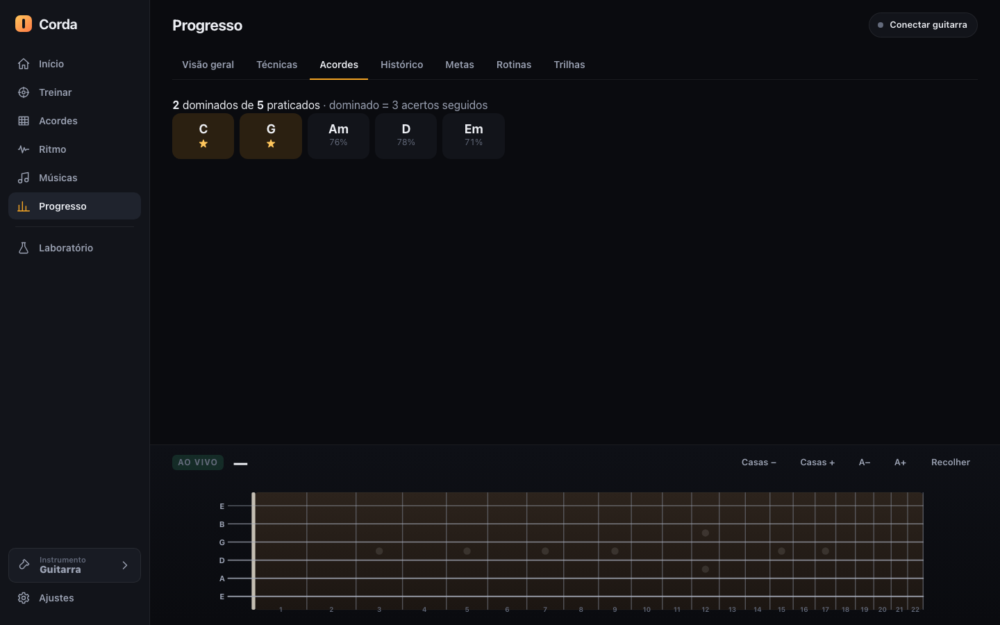
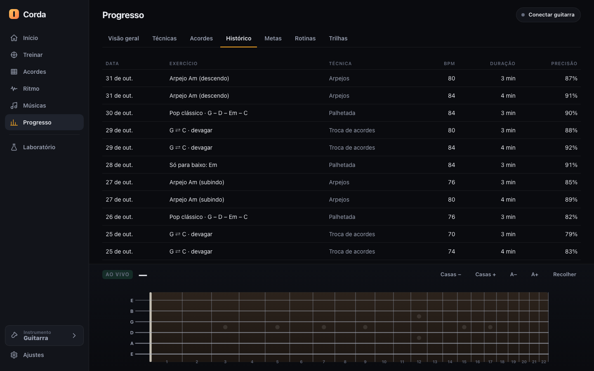
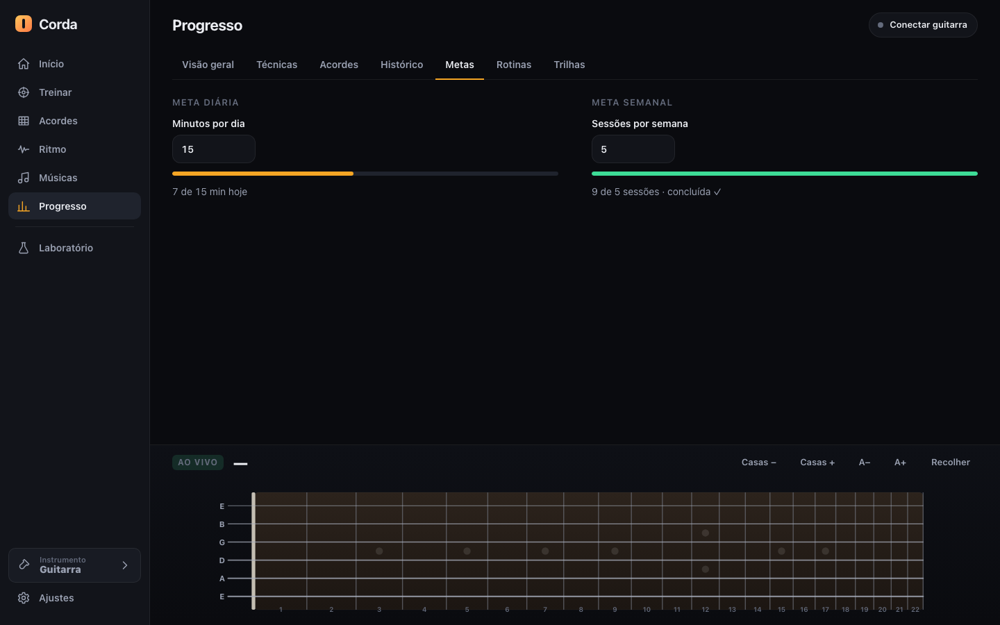
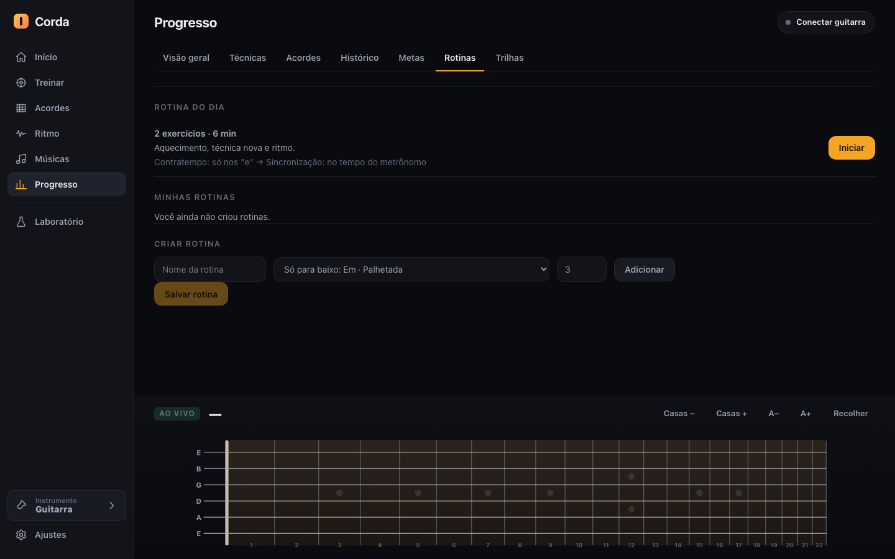
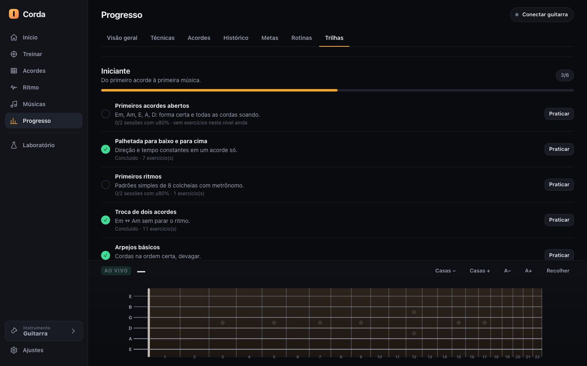

# 06 · Home and Progress

> Part of the Corda documentation for the AeroBand team. See the [index](README.md), [chords](05-chords.md), the [practice engine](03-practice-engine.md) and the [insights for a native app](08-insights-for-native-app.md).

**Evidence legend**

| Tag | Meaning |
|---|---|
| **[CODE]** | A rule that exists in the app's code and unit tests (`tests/learn.test.mjs`, 12 tests). |
| **[VERIFIED-AG01]** | Observed in real AG01 captures (page [01](01-ag01-integration.md)). |
| **[SIMULATED]** | Appears in the screenshots, which use a simulated guitar and **seeded demo data**. |

> **Important about every screenshot on this page.** The statistics shown (63 minutes, 19 sessions, 79% accuracy, a 10-day streak, "2 dominated chords of 5", …) come from **19 fabricated demo sessions** injected by `tools/capture-docs.mjs`. They are not measurements of a real player. The "AeroBand Midi 297b" badge is a **simulated** connection. The *logic* behind each number is real and described below. UI labels are Portuguese (Brazil); translations are in parentheses. The "Músicas" (Songs) menu entry visible in the sidebar is outside the scope of this documentation.

---

## Part A — Home (Início)

### A.1 Purpose

A single screen that answers three questions the moment the app opens: *Am I connected? How much have I practised today? What should I do next?* It carries no settings and no content browsing; everything is a shortcut to somewhere else.

*Figure 6.1 — Home. Greeting, connection badge, daily-goal ring, recommendation card, "continue where you left off", streak, last 7 days and shortcuts. Live fretboard dock at the bottom. [SIMULATED]*

### A.2 Layout, top to bottom **[CODE]**

| Block | What it shows | Source of the value |
|---|---|---|
| **Greeting** ("Boa tarde") | Good morning / afternoon / evening depending on the local hour | `new Date().getHours()` |
| **Sub-title** ("Faltam 8 min para a meta de hoje.") | Remaining minutes for today's goal, "Meta de hoje concluída. Dá para ir além." when the goal is met, or an invitation to connect and do a first exercise for a brand-new user | daily goal − minutes practised today |
| **Connection badge** | `GUITARRA CONECTADA` (green) + hint "Toque uma corda para ver o braço reagir." when connected; an onboarding card with *Conectar guitarra* and *Experimentar sem guitarra* (try without a guitar = demo mode) buttons when not | `guitar.status` |
| **Daily-goal ring** | Big number = minutes done today, small text "de 15 min"; ring fills to the ratio (capped at 100%) | `dailyProgress()` |
| **Weekly sessions** | "9 de 5 sessões na semana" | `weeklyProgress()` — sessions since last Monday 00:00 |
| **Ajustar metas** | Link to Progress → Metas | navigation |
| **Próximo passo** (Next step) card | Title + reason + **Praticar agora** and **Rotina do dia** buttons | `recommend()` (see A.4) |
| **Continuar de onde parou** (Continue where you left off) | Last finished exercise, its technique, when ("hoje") and accuracy ("87%") | last normalized session |
| **Sequência** (Streak) | Consecutive practice days, "10 dias seguidos" | `streak()` |
| **Últimos 7 dias** | Seven bars, minutes per day, today highlighted | `minutesByDay(days: 7)` |
| **Shortcut chips** | Acordes · Ritmo · Treinar · Músicas · Progresso | navigation |

The page works with **zero data**: with no sessions the recommendation reads "Primeiro passo" (First step) and the ring shows 0.

### A.3 Goals **[CODE]**

Defaults `{ dailyMinutes: 15, weeklySessions: 5 }`. They are clamped on every read: daily **1–240** minutes, weekly **1–50** sessions, rounded to integers. The weekly counter resets on **Monday** (`weekStart` returns the Monday 00:00 of the local week). The streak rule is described in B.1.

### A.4 The recommendation engine **[CODE]**

`recommend({sessions, progress, now})` returns one card. The decision order is:

1. **Weakest technique first.** `weakTechniques()` looks at sessions in the last **30 days** that have a technique and an accuracy; for each technique takes the last **5** sessions; ignores techniques with fewer than 2 sessions; flags it as weak if the mean accuracy is **< 80%** *or* more than **25%** of hits were misses. The weakest (score `100 − accuracy + 20·missRatio`) wins. Card label: **"Recomendado: reforço"** (Recommended: reinforcement).
2. **Else the next step of the learning path** (see B.7): the first unfinished step of the first unfinished path. Card label: **"Próximo passo"** with the reason "Próximo passo da trilha Iniciante." (Figure 6.1 shows "Primeiros acordes abertos").
3. **Else a free-play suggestion.** With no history at all: **"Primeiro passo"**. When every path step is done: **"Tudo em dia"** (All up to date).

**Praticar agora** opens the Train screen filtered by that technique and level; **Rotina do dia** opens the daily routine (B.6).

### A.5 Edge cases **[CODE]**

- A day without practice does **not** break a streak if it is *today* (the day is not over yet); it breaks it only if *yesterday* is also empty.
- Time is always the **local** calendar date (`dayKey` builds `YYYY-MM-DD` from local fields, not UTC), so midnight rollovers happen at the user's midnight.
- Legacy sessions from an older storage format (`{date, mode, accuracy, bpm}`) are normalized on read (`kind: 'rhythm'`, noon of that date).

---

## Part B — Progress (Progresso)

### B.0 Structure

Seven tabs: **Visão geral** (Overview) · **Técnicas** (Techniques) · **Acordes** (Chords) · **Histórico** (History) · **Metas** (Goals) · **Rotinas** (Routines) · **Trilhas** (Paths). The page "only shows real data": an empty store shows an explicit empty state ("Ainda não há dados — Faça um exercício e seus números aparecem aqui") with a *Começar a treinar* button.

### B.0.1 What a session record contains **[CODE]**

Every finished exercise (from Train, Chords, Rhythm) calls `app.learn.record()` and stores one normalized entry:

| Field | Meaning |
|---|---|
| `ts` | Finish time (ms) |
| `kind` | `exercise`, `rhythm`, … |
| `refId`, `title` | Which exercise (e.g. "G ⇌ C · devagar") |
| `technique` | One of: chords, chord-change, strumming, picking, rhythm, arpeggio, fingerpicking, scale, melody, legato |
| `level` | 1–5 |
| `bpm`, `speed` | Written tempo and speed factor; **effective BPM = round(bpm × speed)** |
| `durationSec` | Time practised |
| `accuracy` | 0–100 |
| `timingMeanMs` | Mean timing error; **negative = early** |
| `hits` | Count per grade (perfect/good/ok/miss…) |
| `stringsOk/Total`, `chordsOk/Total` | Strings and chords right out of expected |

No audio, no raw MIDI and no personal data are stored. Everything lives in the browser's local storage (`corda.v2`).

### B.1 Visão geral (Overview)

*Figure 6.2 — Overview: four stat tiles, 14-day practice bars, accuracy line. (Below the fold: mean timing and BPM evolution.) [SIMULATED]*

**Tiles [CODE]**

| Tile | Calculation |
|---|---|
| **Tempo total** | Sum of `durationSec`/60 over all sessions; sub-label "N min nesta semana" (since Monday) |
| **Sessões** | Count; sub-label "N nesta semana" |
| **Precisão média** | Mean of all non-null accuracies; sub-label shows **trend** `▲/▼ N pts` once there are **≥ 6** accuracy values: mean of the second half minus mean of the first half. Before that: "tendência após 6 sessões" |
| **Sequência** | Consecutive days ending today (or yesterday); sub-label "recorde N dias" (best run ever). Days come from the union of saved day keys and session dates |

**Charts [CODE]** (all drawn as dependency-free SVG, `js/learn/charts.js`: `barChart`, `lineChart`, `hBars`, `ring`)

1. **Tempo de prática · 14 dias** — one bar per day, today highlighted in orange; axis uses a "nice" maximum.
2. **Precisão por sessão** — line chart 0–100%, needs ≥ 2 sessions ("Precisa de pelo menos 2 sessões" otherwise).
3. **Timing médio (ms; negativo = adiantado)** — line chart, only sessions with timing (those recorded with a guitar; demo sessions have none).
4. **Evolução de BPM (efetivo)** — line chart of effective BPM with accuracy as tooltip note; a dropdown filters by technique ("Todas" or any technique present).

### B.2 Técnicas (Techniques)

*Figure 6.3 — Mean accuracy per technique (horizontal bars with "75% · 9×" = mean · number of sessions) and the "needs reinforcement" list. Here nothing is below 80%, so the explanatory sentence appears. [SIMULATED]*

- Bars are sorted by **minutes practised**, then by session count.
- A technique flagged weak (A.4 rule) is drawn in a warning colour and listed under **Precisam de reforço** with "média N% nas últimas M sessões" plus the miss ratio when ≥ 25%. Each row has a button that jumps to Train filtered by the technique.
- Only techniques with **≥ 2 sessions** are evaluated (stated in the empty text: "Só avaliamos técnicas com 2 ou mais sessões").

### B.3 Acordes (Chords)

*Figure 6.4 — "2 dominados de 5 praticados · dominado = 3 acertos seguidos". Mastered chords (gold ★) come first, then the others with their hit rate. [SIMULATED]*

Shows every chord with at least one attempt (`tries > 0`), the hit percentage `ok / tries`, and a ★ for **mastered = 3 consecutive correct attempts** (`streak ≥ 3`; a wrong attempt resets it, see [05](05-chords.md) §3.5). Sorting: mastered first, then alphabetical. The tooltip of each tile reads "N acertos em M tentativas".

### B.4 Histórico (History)

*Figure 6.5 — The last 100 sessions, newest first: date, exercise, technique, effective BPM, duration, accuracy. [SIMULATED]*

A plain table (no editing, no deletion in this build). Duration shows minutes, or seconds for very short sessions; missing values show "—".

### B.5 Metas (Goals)

*Figure 6.6 — Daily goal (minutes) and weekly goal (sessions) with progress bars; the weekly bar turns green with "concluída ✓" when reached. [SIMULATED]*

Two numeric inputs with immediate effect (`change` event → `setGoals` → redraw): **Minutos por dia** (1–240) and **Sessões por semana** (1–50). Under each, a bar plus text such as "7 de 15 min hoje" and "9 de 5 sessões · concluída ✓" (the counter keeps counting past the target; the bar saturates).

### B.6 Rotinas (Routines)

*Figure 6.7 — "Rotina do dia" suggestion (2 exercises · 6 min), the user's saved routines, and the routine builder. [SIMULATED]*

A **routine** is an ordered list of library exercises, each with minutes. Two sources:

**1. Rotina do dia (suggested)** **[CODE]** — `suggestDaily` builds about `dailyMinutes / 3` steps of 3 minutes each, choosing in order: (a) the chords the user has not mastered, (b) weak techniques, (c) the next technique of the path, (d) a rhythm exercise, (e) a strumming exercise. The card states its reasons in plain text ("Aquecimento, técnica nova e ritmo.") and lists the steps with arrows. **Iniciar** (Start) plays them one after another using the shared practice player; **Pular** (Skip) and **Encerrar** (Stop) are available while running; finishing shows the toast "Rotina concluída!".

**2. Minhas rotinas (custom)** **[CODE]** — name (≤ 40 characters), pick an exercise from the library, minutes per step (≤ 30), *Adicionar* (Add), *Salvar rotina*. Saved routines can be started or deleted.

In the demo screenshot the library is available. When the exercise library is missing, the tab says so ("A biblioteca de exercícios ainda não está disponível…") instead of failing.

### B.7 Trilhas (Learning paths)

*Figure 6.8 — Path "Iniciante" with 3/6 steps done; each step shows its hint, its criterion ("0/2 sessões com ≥80%"), how many library exercises are available and a **Praticar** button. [SIMULATED]*

Three paths **[CODE]** (`js/content/paths.js`):

| Path | Level | Steps | Theme |
|---|---|---|---|
| **Iniciante** | 1 | 6 | First open chords → up/down strumming → first rhythms → two-chord change → basic arpeggios → first scale |
| **Intermediário** | 3 | 8 | Barre and seventh chords → alternate picking → off-beat patterns → full progressions → arpeggios per chord → PIMA fingerpicking → scales in several positions → legato |
| **Avançado** | 4 | 7 | Extended voicings and inversions → picking speed → syncopation → fast changes → fingerstyle with melody → melodic sequences → melodies |

A step is a *specification* (technique + levels + criterion), not a fixed exercise. It is **done** when there are `sessions` qualifying sessions (default **2**) of that technique, at the step's levels, with accuracy ≥ `minAccuracy` (default **80%**; some steps use 70% or 75%). Progress is **derived** from the history every time, so it can always be recomputed and cannot get out of sync. The page also supports a manual `paths.completed` override for the future.

---

## C. How these pieces connect to the guitar

- The **only** things the guitar contributes are the events that make a session valid: notes (strum detection) and the fret-sensor CC 49/50 (assembly drills). Timing means, hit counts and per-string results derive from them **[VERIFIED-AG01 for the event types; CODE for the maths]**.
- Without a guitar (demo/simulation) the app records sessions with `accuracy` but no `timingMeanMs`; the "Timing médio" chart stays empty on purpose.
- Nothing is sent to the guitar and nothing is sent to a server **[CODE; enforced by `tests/safety.test.mjs` for the guitar side]**.

---

## D. Limitations and honesty

1. **Accuracy is app-defined.** It is a weighted score of hit grades (perfect/good/ok/miss) inside windows that depend on BPM, subdivision and the tolerance setting; it is not a standard musical metric and is not comparable across tolerance settings.
2. **Not validated with many real players.** The 80% weak-technique threshold, the "3 in a row" mastery rule, the 6-session trend minimum and the 3-minute routine steps are pragmatic defaults chosen by the developer; they have not been tuned with a user study.
3. **Streaks are local.** They live in one browser profile; clearing site data erases history. There is no export in this build.
4. **Technique tagging depends on the exercise author.** Exercises declare their technique; the app does not detect it from the playing.
5. **Demo data in the screenshots** is synthetic and smoothly rising; real data is noisier.
6. **Time zone / device clock.** Everything uses the device's local clock; travelling users or wrong clocks can shift days.

---

## E. Ideas for the native AeroBand app

1. **One-screen "what now?" Home.** Greeting + goal ring + a single recommended action is enough; the weakest-technique-first rule gives a personalised feel without any account or cloud.
2. **Derived progress.** Store only sessions; compute path steps, streaks, mastery and trends on the fly. It keeps the numbers always consistent with the history and makes rule changes retroactive.
3. **Negative-is-early timing chart.** A signed mean timing error (in ms) is more instructive than a single score; players quickly learn if they rush or drag.
4. **Effective BPM** (written BPM × speed) as the key progress axis for speed building, with accuracy shown next to it so players do not chase tempo at the cost of cleanliness.
5. **Daily routine generator** from weak spots + the next path step, with short fixed-length steps (3 min); it turns "I don't know what to practise" into one tap.
6. **Honest empty states** instead of fake numbers.
7. **Hardware-aware metrics.** If the instrument could expose a battery of cheap per-session metrics (strum spread, fret-change time between chords measured from CC 49/50), the native app could chart *hand-change time*, a number no microphone-based app can offer. See [08](08-insights-for-native-app.md).
8. **Sync and export** (cloud or file) as the obvious step beyond this local-only prototype.
