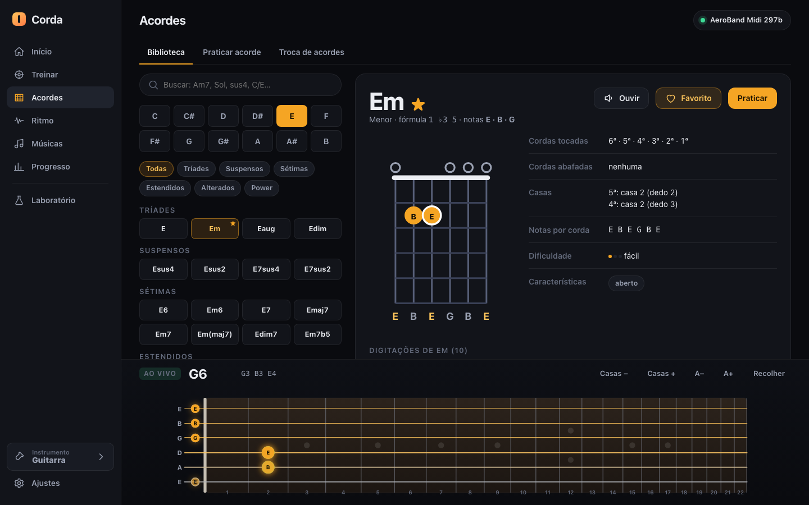
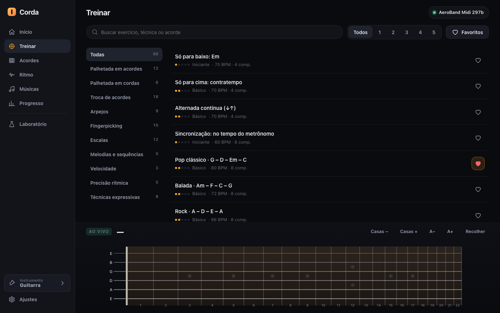
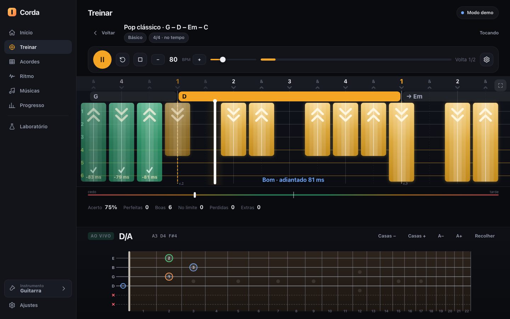
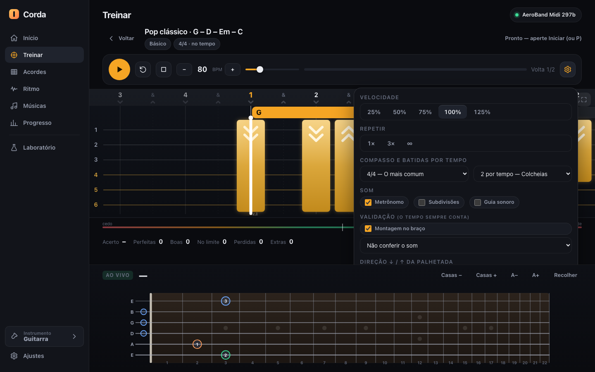
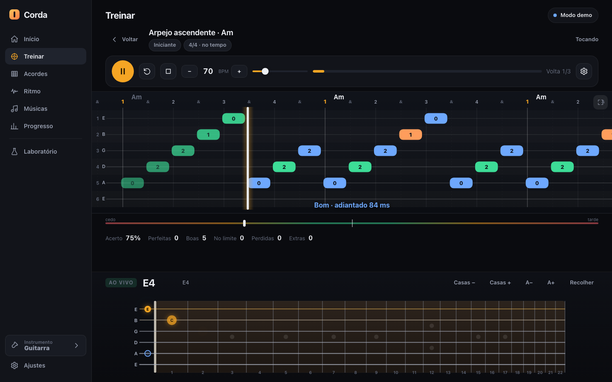
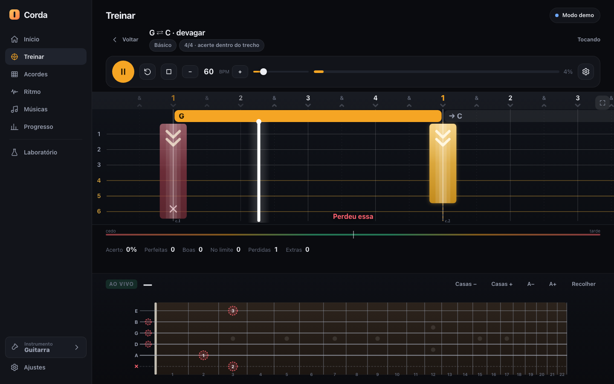
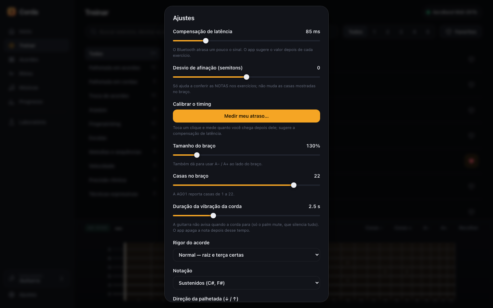
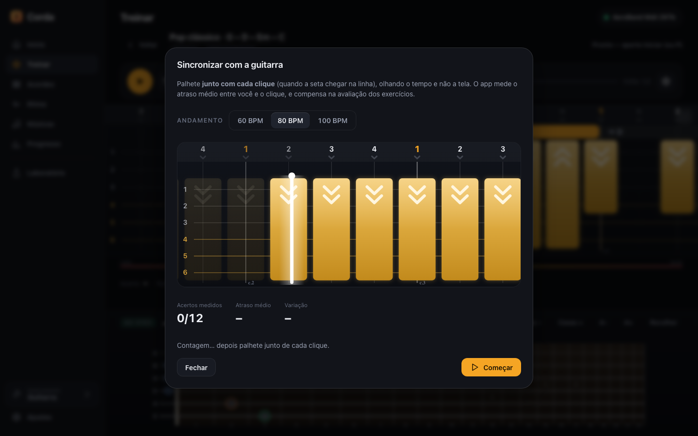
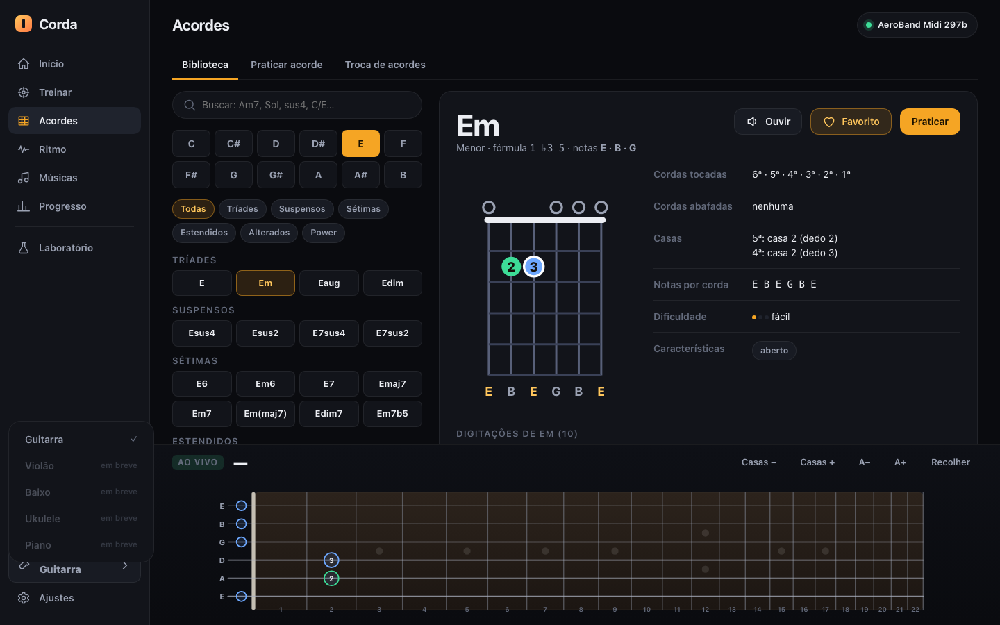

# Screenshot index

All 34 screenshots in one place, in the order they appear in the app. They are **simulated**: produced by a headless Chrome at 1440×900 that drives the app with emulated guitar events and demonstration data (19 generated practice sessions); no real guitar was attached and no personal data appears. The interface language is Brazilian Portuguese. They can be regenerated with `node tools/capture-docs.mjs`.

| # | File | What it shows | Page |
|---|---|---|---|
| 01 |  | Home: daily-goal ring, next step, streak, last 7 days | [06](06-home-and-progress.md) |
| 02 |  | Live fretboard right after a strum (plucked notes with names) and two pressed frets | [02](02-live-fretboard.md) |
| 03 |  | Pressed frets only (no strum yet) | [02](02-live-fretboard.md) |
| 04 |  | Exercise library: techniques, levels, favourites | [03](03-practice-engine.md) |
| 05 |  | A running strum exercise: timeline, hit blocks, ✓ and ms | [03](03-practice-engine.md) |
| 06 |  | The exercise settings popover (⚙) | [03](03-practice-engine.md) |
| 07 |  | Note highway for an arpeggio exercise | [03](03-practice-engine.md) |
| 08 |  | Chord-change lane with the "TROQUE →" cue | [03](03-practice-engine.md) |
| 09 |  | Chord library | [05](05-chords.md) |
| 10 |  | Chord detail: voicings, difficulty, notes | [05](05-chords.md) |
| 11 |  | Free chord practice with strum-direction chips | [05](05-chords.md) |
| 12 |  | Right chord, wrong strum direction | [05](05-chords.md) |
| 13 |  | Chord-change drill types | [05](05-chords.md) |
| 14 |  | Chord-assembly setup (hold time, optional strum) | [05](05-chords.md) |
| 15 |  | Chord assembly running | [05](05-chords.md) |
| 16 |  | Visual chord picker (modal) | [05](05-chords.md) |
| 17 |  | Variations tab for a chord already in the sequence | [05](05-chords.md) |
| 18 |  | Metronome with the scrolling lane | [04](04-rhythm.md) |
| 19 |  | Strumming patterns | [04](04-rhythm.md) |
| 20 |  | Chord progressions in rhythm | [04](04-rhythm.md) |
| 21 |  | Simple pattern builder (per-string grid) | [04](04-rhythm.md) |
| 22 |  | Semi-tablature builder with several strums selected and set to ↑ | [04](04-rhythm.md) |
| 23 |  | Rhythm level path | [04](04-rhythm.md) |
| 24 |  | Progress → Overview | [06](06-home-and-progress.md) |
| 25 |  | Progress → Techniques | [06](06-home-and-progress.md) |
| 26 |  | Progress → Chords | [06](06-home-and-progress.md) |
| 27 |  | Progress → History | [06](06-home-and-progress.md) |
| 28 |  | Progress → Goals | [06](06-home-and-progress.md) |
| 29 |  | Progress → Routines | [06](06-home-and-progress.md) |
| 30 |  | Progress → Learning paths | [06](06-home-and-progress.md) |
| 31 |  | Laboratory: raw event log, sound monitor, capability table | [07](07-settings-calibration-lab.md) |
| 32 |  | Settings dialog | [07](07-settings-calibration-lab.md) |
| 33 |  | Timing calibration (click-along) | [07](07-settings-calibration-lab.md) |
| 34 |  | Instrument menu (guitar active, others "coming soon") | [07](07-settings-calibration-lab.md) |
